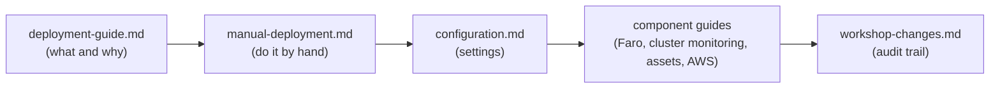

<!-- markdownlint-disable MD013 -->

# Documentation index (workshop branch)

Start with the row that matches what you want to do.

| I want to... | Read |
|---|---|
| Get the demo running quickly with the 1-click scripts | [deployment-guide.md](deployment-guide.md) |
| Do every step **by hand**, click by click, with a check after each step | [manual-deployment.md](manual-deployment.md) |
| Know **exactly what was changed**, why, and how it was verified | [workshop-changes.md](workshop-changes.md) |
| Look up a setting (every variable, its default, where to find it) | [configuration.md](configuration.md) |
| Send **browser** monitoring (Faro) or **profiles** (Pyroscope) to Grafana Cloud | [faro-and-pyroscope.md](faro-and-pyroscope.md) |
| Monitor the **Kubernetes cluster** in Grafana Cloud (activation, install, removal) | [grafana-cloud-k8s-monitoring.md](grafana-cloud-k8s-monitoring.md) |
| Load SLOs, synthetic checks and k6 tests | [grafana-assets.md](grafana-assets.md) |
| Deploy to **AWS** (costs, permissions, teardown) | [aws-deployment.md](aws-deployment.md) |
| Run the demo **without** collecting telemetry | [otel-noop-mode.md](otel-noop-mode.md) |
| See the original plan and its execution log | [workshop-port-plan.md](workshop-port-plan.md) |

## Reading order for a newcomer

## Conventions used in all documents

- **Do / Expect / If not:** an action, what you should see, and what to check otherwise.
- `docker-desktop` in commands is the name of the Kubernetes context; replace it with `minikube` or `orbstack` if you use those.
- Values like `1234567` or `https://otlp-gateway-prod-us-east-2.grafana.net/otlp` are **examples**: use your own.
- Nothing in these documents asks you to put a secret into a file that Git tracks.
