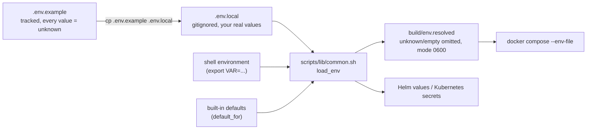

<!-- markdownlint-disable MD013 -->

# Configuration reference

Every environment-specific value of the workshop is an environment variable. This page lists all of them.

## How configuration is loaded

Precedence, highest first: **shell environment**, then **`.env.local`**, then the **built-in default**. A value that is empty or `unknown` counts as *not set*.

- The upstream `.env` (ports, image versions, ...) is never edited; `.env.local` is layered on top of it.
- `.env.local` is listed in `.gitignore`; do not commit it. Scripts create it from `.env.example` (mode 0600) when it is missing.
- Values without a safe default (endpoints, IDs, tokens) make the script stop and print where to find them (`require_vars`). Fix `.env.local` and re-run: the script continues from the first missing requirement.
- `scripts/make-env.sh` writes `build/env.resolved` without deploying anything (use it for the manual route in [manual-deployment.md](manual-deployment.md)). **Never pass `.env.local` itself to Docker Compose**: it still contains the `unknown` placeholders and comments.
- `build/env.resolved` is rewritten on every run and is gitignored; it exists so that the `unknown` placeholder never reaches a container.

## Variables

Default = value used when the variable is empty or `unknown`. **—** means there is no default and a script that needs the value stops until you set it. Secrets are marked **secret**.

### Grafana Cloud: OTLP (traces, metrics, logs from the OpenTelemetry Collector)

| Variable | Default | Secret | Used by | Meaning |
|---|---|:---:|---|---|
| `GRAFANA_OTLP_ENDPOINT` | — |  | start-local.sh (--grafana-cloud, --k8s-grafana-cloud, --k8s-alloy-collector), deploy-aws.sh --grafana-cloud, k8s-monitoring install.sh | e.g. `https://otlp-gateway-<region>.grafana.net/otlp` |
| `GRAFANA_INSTANCE_ID` | — |  | same as GRAFANA_OTLP_ENDPOINT | numeric OTLP instance ID (basic-auth user) |
| `GRAFANA_CLOUD_APIKEY` | — | **secret** | same as GRAFANA_OTLP_ENDPOINT | Access policy token with metrics/logs/traces:write |

### Grafana Faro (browser real-user monitoring). Optional

| Variable | Default | Secret | Used by | Meaning |
|---|---|:---:|---|---|
| `GRAFANA_FARO_ENDPOINT` | — |  | frontend (docker-compose.yml, Helm extras); triggers a local image build | Faro collector URL (Grafana Cloud > Frontend Observability). Unset: the stock OpenTelemetry browser tracer runs instead. |

### Grafana Pyroscope (continuous profiling of the checkout service). Optional

| Variable | Default | Secret | Used by | Meaning |
|---|---|:---:|---|---|
| `GRAFANA_PYROSCOPE_ADDR` | — |  | checkout (docker-compose.yml, Helm extras); enables profiling; triggers a local image build | Pyroscope / Grafana Cloud Profiles URL. Unset: profiling is off. |
| `GRAFANA_PYROSCOPE_AUTH_USER` | — |  | checkout | Basic-auth user of the profiles endpoint. |
| `GRAFANA_PYROSCOPE_AUTH_PASS` | — | **secret** | checkout (Kubernetes: delivered through a secret) | Basic-auth password or token of the profiles endpoint. |

### Grafana Cloud: Kubernetes monitoring (scripts/grafana-cloud-k8s-monitoring)

| Variable | Default | Secret | Used by | Meaning |
|---|---|:---:|---|---|
| `GRAFANA_CLOUD_TOKEN` | — | **secret** | scripts/grafana-cloud-k8s-monitoring/install.sh | Access policy token with scopes metrics:write, logs:write, traces:write, profiles:write. |
| `GRAFANA_CLOUD_METRICS_URL` | — |  | k8s-monitoring install.sh | Prometheus remote-write URL, ending in /api/prom/push. |
| `GRAFANA_CLOUD_METRICS_USER` | — |  | k8s-monitoring install.sh | Numeric user of the metrics destination. |
| `GRAFANA_CLOUD_LOGS_URL` | — |  | k8s-monitoring install.sh | Loki push URL, ending in /loki/api/v1/push. |
| `GRAFANA_CLOUD_LOGS_USER` | — |  | k8s-monitoring install.sh | Numeric user of the logs destination. |
| `GRAFANA_CLOUD_PROFILES_URL` | — |  | k8s-monitoring install.sh | Profiles URL including the :443 port. |
| `GRAFANA_CLOUD_PROFILES_USER` | — |  | k8s-monitoring install.sh | Numeric user of the profiles destination. |
| `K8S_MONITORING_CHART_VERSION` | `4.6.0` |  | k8s-monitoring install.sh | Exact chart version of grafana/k8s-monitoring (validated with helm template). |
| `K8S_MONITORING_NAMESPACE` | `grafana-k8s-monitoring` |  | k8s-monitoring install.sh, start-local.sh --k8s-alloy-forward | Namespace of the k8s-monitoring release. |
| `K8S_CLUSTER_NAME` | current kubectl context |  | k8s-monitoring install.sh | Cluster identifier shown in Grafana Cloud. |
| `GRAFANA_STACK_URL` | — |  | k8s-monitoring install.sh | Your stack's URL, e.g. `https://<stack>.grafana.net`. Only used to print or open the link to the activation page. |
| `GCX_CONTEXT` | — |  | k8s-monitoring install.sh | The `gcx` context of **this** stack. With it, the installer (1) fills the unset `GRAFANA_CLOUD_METRICS_*`, `GRAFANA_CLOUD_LOGS_*` and `GRAFANA_CLOUD_PROFILES_*` values and `GRAFANA_STACK_URL` from the stack (`gcx cloud stacks get`; needs a `gcx cloud login` for that context; values you set are never overwritten) and (2) checks after the install that cluster data arrives. It is never guessed: unset means neither happens. |
| `K8S_MONITORING_ACTIVATED` | — |  | k8s-monitoring install.sh | Set to `true` once you activated Kubernetes Monitoring in the UI (this starts billing). Same as `--i-have-activated`; needed when the script has no terminal. |
| `K8S_MONITORING_VERIFY_MINUTES` | `6` |  | k8s-monitoring install.sh | How long to wait for the cluster's `kube_pod_info` after the install. |
| `K8S_MONITORING_RELEASE` | `grafana-k8s-monitoring` |  | k8s-monitoring install.sh, start-local.sh --k8s-alloy-forward | Helm release name; the Alloy receiver service is named `<release>`-alloy-receiver. |

### Kubernetes deployment (Helm)

| Variable | Default | Secret | Used by | Meaning |
|---|---|:---:|---|---|
| `OTEL_DEMO_CHART_VERSION` | `0.37.8` |  | start-local.sh (Kubernetes modes), deploy-aws.sh | open-telemetry/opentelemetry-demo chart version; 0.37.8 ships demo 2.0.2, the version on this branch. |
| `OTEL_DEMO_NAMESPACE` | `otel-demo` |  | start-local.sh (Kubernetes modes), deploy-aws.sh, teardown-aws.sh | Kubernetes namespace of the demo. |
| `OTEL_DEMO_RELEASE` | `opentelemetry-demo` |  | start-local.sh (Kubernetes modes), deploy-aws.sh, teardown-aws.sh | Helm release name of the demo. |
| `K8S_CONTEXT` | first of `orbstack`, `docker-desktop`, `minikube` that exists |  | start-local.sh, k8s-monitoring install.sh | kubectl context to use. Only local clusters are auto-selected; set this to use any other. |
| `ALLOY_CHART_VERSION` | `1.8.1` |  | start-local.sh --k8s-alloy-collector | Chart version of grafana/alloy used by --k8s-alloy-collector. |
| `MINIKUBE_CPUS` | `4` |  | start-local.sh (only when it offers to start minikube) | CPUs for a minikube cluster the script starts. |
| `MINIKUBE_MEMORY_MB` | `8192` |  | same as MINIKUBE_CPUS | Memory in MB for that cluster. |

### Demo images (Docker Compose)

| Variable | Default | Secret | Used by | Meaning |
|---|---|:---:|---|---|
| `DEMO_VERSION` | `2.0.2` |  | start-local.sh (Compose modes), `docker compose build` | Image tag of the demo services. The upstream `.env` says `latest`, which pulls whatever upstream published last (found by the smoke test: `latest-flagd-ui` crashes without `SECRET_KEY_BASE`, `latest-kafka` fails its health check). 2.0.2 matches Helm chart 0.37.8. |

### Load generator (lean default is 5 users; upstream uses 10)

| Variable | Default | Secret | Used by | Meaning |
|---|---|:---:|---|---|
| `LOCUST_USERS` | `5` |  | docker compose (load generator); Kubernetes uses the chart default | Simulated shoppers of the load generator (lean default 5). |

### AWS (scripts/deploy-aws.sh, scripts/teardown-aws.sh)

| Variable | Default | Secret | Used by | Meaning |
|---|---|:---:|---|---|
| `AWS_REGION` | `AWS_DEFAULT_REGION`, then `aws configure`, then `us-east-1` |  | deploy-aws.sh, teardown-aws.sh | AWS region. |
| `EKS_CLUSTER_NAME` | `otel-demo` |  | deploy-aws.sh, teardown-aws.sh | EKS cluster name. |
| `EKS_K8S_VERSION` | `1.33` |  | deploy-aws.sh | Kubernetes version of the cluster. |
| `EKS_NODE_TYPE` | `t3.xlarge` |  | deploy-aws.sh | EC2 instance type of the nodes. |
| `EKS_NODE_COUNT` | `2` |  | deploy-aws.sh | Desired node count. |
| `EKS_NODE_MIN` | `1` |  | deploy-aws.sh | Minimum node count. |
| `EKS_NODE_MAX` | `4` |  | deploy-aws.sh | Maximum node count. |
| `AWS_RESOURCE_TAG_KEY` | `project` |  | deploy-aws.sh, teardown-aws.sh | Tag key put on every AWS resource; teardown finds resources by it. |
| `AWS_RESOURCE_TAG_VALUE` | `opentelemetry-demo` |  | deploy-aws.sh, teardown-aws.sh | Tag value; keep it identical between deploy and teardown. |

### Grafana-side assets (SLOs, synthetic checks, k6): rendered by scripts/render-assets.sh

| Variable | Default | Secret | Used by | Meaning |
|---|---|:---:|---|---|
| `DEMO_TARGET_URL` | — |  | scripts/render-assets.sh | URL where Grafana Cloud probes and k6 can reach the shop, e.g. http://`<load-balancer-hostname>`:8080. |
| `DEMO_ENVIRONMENT` | `workshop` |  | scripts/render-assets.sh | Value of the env label on SLOs and checks. |
| `GRAFANA_CLOUD_PROM_DATASOURCE_UID` | `grafanacloud-prom` |  | scripts/render-assets.sh | UID of your stack's Prometheus data source (SLO destination). |

## Format of `.env.local`

One `KEY=value` per line, no spaces needed. The scripts read the file themselves; they do **not** run it as a shell script, so characters such as `$`, `&` or `#` inside a token are safe.

- A value is its first word. Text after it is dropped, and the script warns about it unless it is a `# comment`.
- Put the value in single or double quotes only if it contains spaces.
- Lines that are not `KEY=value` (comments, blank lines, lowercase names) are ignored.
- Test: `scripts/tests/env-parser-test.sh`.

## The `.env*` files in the repository root

| File | Tracked | Who owns it | Read by |
|---|:---:|---|---|
| `.env` | yes | upstream | Docker Compose and the scripts: ports, image names, service addresses |
| `.env.override` | yes (empty) | you | Docker Compose, after `.env`; upstream's place for local overrides |
| `.env.arm64` | yes | upstream | the scripts and the upstream Makefile, on Apple Silicon only: `_JAVA_OPTIONS=-XX:UseSVE=0` |
| `.env.example` | yes | this workshop | nothing at run time: the template that lists every workshop variable |
| `.env.local` | **no** (gitignored) | you | the workshop scripts: your real values and secrets |

Compose receives them in this order, later files winning: `.env`, `.env.override`, `.env.arm64`
(Apple Silicon), then `build/env.resolved` (your `.env.local` plus defaults).

## Checking your configuration

- `./start-local.sh --status` loads the configuration and shows what is deployed.
- Any script prints, for a missing required value, the exact portal path where the value is found.
- To see what Docker Compose will receive: `cat build/env.resolved` (it contains secrets; do not paste it anywhere).

## Related

- [Deployment guide](deployment-guide.md)
- [Faro and Pyroscope](faro-and-pyroscope.md)
