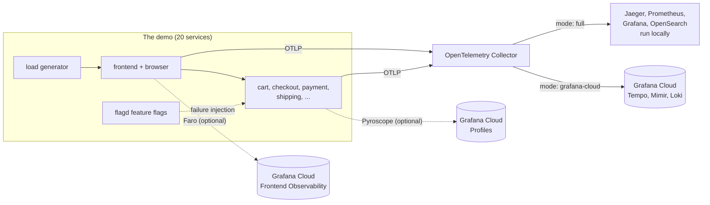
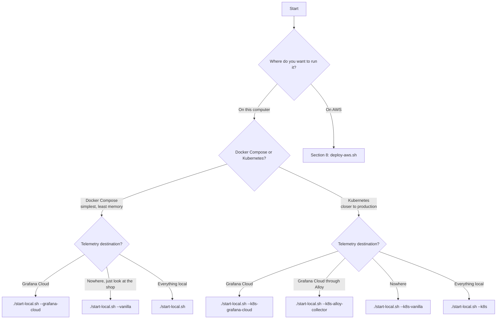
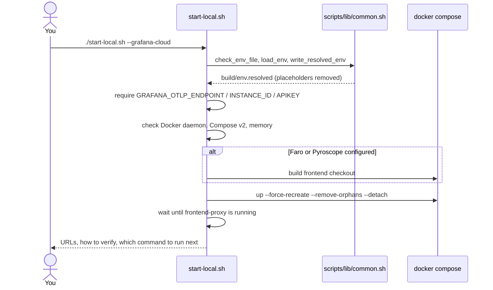
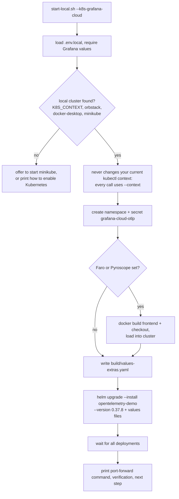
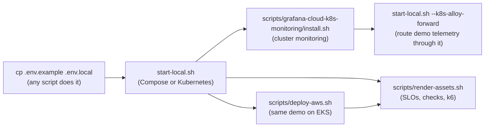

<!-- markdownlint-disable MD013 MD024 MD031 -->

# Deployment guide

> **Documents in this set:** this guide (overview, 1-click scripts) |
> [manual-deployment.md](manual-deployment.md) (every step by hand, click by click, with checks) |
> [workshop-changes.md](workshop-changes.md) (everything that was changed, why, and how it was verified) |
> [configuration.md](configuration.md) (every variable). Index: [README.md](README.md).

This is the master guide for the workshop branch. It takes you from an empty
machine to a running OpenTelemetry Demo that sends its telemetry to Grafana
Cloud. Every step can be done with a **1-click script** or by hand; both are
described side by side, so you can start with the script and switch to the manual
steps at any point (each script prints the matching section of this guide).

- [1. What you are deploying](#1-what-you-are-deploying)
- [2. Choose a path](#2-choose-a-path)
- [3. Prerequisites](#3-prerequisites)
- [4. Get the code and configure it](#4-get-the-code-and-configure-it)
- [Docker Compose](#docker-compose)
- [Kubernetes](#kubernetes)
- [5. Faro and Pyroscope (optional)](#5-faro-and-pyroscope-optional)
- [6. Monitor the cluster itself (optional)](#6-monitor-the-cluster-itself-optional)
- [7. SLOs, synthetic checks and k6 (optional)](#7-slos-synthetic-checks-and-k6-optional)
- [8. AWS (optional)](#8-aws-optional)
- [9. Undeploy and reset](#9-undeploy-and-reset)
- [10. Script index: what to run next](#10-script-index-what-to-run-next)
- [11. Troubleshooting](#11-troubleshooting)

## 1. What you are deploying

The OpenTelemetry Astronomy Shop: about 20 microservices written in many
languages (frontend, cart, checkout, payment, shipping, ...), a load generator and
a feature-flag service that injects failures. Every service emits traces, metrics
and logs through an OpenTelemetry SDK to a collector.



This branch is the 2025 upstream demo (version 2.0.2) plus: a Grafana-Cloud-only
mode that needs no local backends, optional Faro browser monitoring and Pyroscope
profiling, deployment scripts for Docker Compose, local Kubernetes and AWS EKS,
and SLO / synthetic-check / k6 assets. See [workshop-port-plan.md](workshop-port-plan.md)
for how the branch was built.

## 2. Choose a path



| Mode | What runs | Needs Grafana Cloud values |
|---|---|:---:|
| `./start-local.sh` | demo + Jaeger + Prometheus + Grafana + OpenSearch | no |
| `./start-local.sh --grafana-cloud` | demo + collector -> Grafana Cloud | yes |
| `./start-local.sh --vanilla` | demo + noop collector (telemetry dropped) | no |
| `./start-local.sh --no-otel` | demo + backend UIs, telemetry off | no |
| `./start-local.sh --minimal` | upstream minimal subset | no |
| `--k8s` / `--k8s-vanilla` / `--k8s-clean` | same ideas on Kubernetes (`clean` = no collector at all) | no |
| `--k8s-grafana-cloud` | chart collector -> Grafana Cloud | yes |
| `--k8s-alloy-collector` | Grafana Alloy replaces the collector -> Grafana Cloud | yes |
| `--k8s-alloy-forward` | chart collector -> the Alloy of section 6 | after section 6 |

**Recommended for a workshop:** `--grafana-cloud` (Compose) or `--k8s-grafana-cloud`
(Kubernetes). They run roughly 1.8 GB less than the full mode because Jaeger,
Prometheus, Grafana and OpenSearch do not start.

## 3. Prerequisites

Hardware: 8 GB of memory available to Docker or the cluster (16 GB is more
comfortable), 4 CPU cores, 20 GB of free disk. The scripts check the memory Docker
reports and warn when it is below 8 GB.

Software, macOS (use your package manager on Linux):

| You need it for | Install | Check |
|---|---|---|
| Docker Compose path | OrbStack (`brew install --cask orbstack`) **or** Docker Desktop | `docker info` prints no error |
| Kubernetes path | a local cluster: OrbStack > Settings > Kubernetes > Enable, **or** Docker Desktop > Settings > Kubernetes > Enable, **or** `brew install minikube` | `kubectl config get-contexts` lists `orbstack`, `docker-desktop` or `minikube` |
| Kubernetes path | `brew install kubectl helm` | `kubectl version --client`, `helm version` |
| Git | `xcode-select --install` | `git --version` |
| Optional | `brew install yq shellcheck` | used by `render-assets.sh` and for linting |

Do not run Docker Desktop and OrbStack at the same time: both want the Docker
socket. Quit the one you are not using.

A Grafana Cloud account (the free tier is enough) is needed only for the modes
marked "yes" above. Create one at <https://grafana.com/auth/sign-up/create-user>.

## 4. Get the code and configure it

1. Open a terminal and run:
   ```bash
   git clone https://github.com/rnp68/opentelemetry-demo.git
   cd opentelemetry-demo
   git checkout workshop
   ```
   (`git checkout workshop` works once the `workshop` branch has been pushed to
   that repository. If you already have the repository on your machine, just run
   `git checkout workshop` in it.)
2. Create your configuration file. **1-click:** any script does this for you the
   first time. **Manual:**
   ```bash
   cp .env.example .env.local
   chmod 600 .env.local
   ```
   `.env.local` is ignored by git. Every value in `.env.example` is `unknown`, which
   means "use the default, or stop and tell me what to enter". The full list is in
   [configuration.md](configuration.md).
3. **Only if you use a Grafana Cloud mode**, fill in these three values. Open
   `.env.local` in a text editor (`open -e .env.local`) and replace `unknown`:

   | Variable | Where to find it, click by click |
   |---|---|
   | `GRAFANA_OTLP_ENDPOINT` | Grafana Cloud > open (Launch) your stack > **Connections** > search **OpenTelemetry** > open the tile > copy the **OTLP endpoint** (ends in `/otlp`). With `gcx`: `gcx --context <ctx> cloud stacks get <slug>` and build `https://otlp-gateway-<clusterSlug>.grafana.net/otlp` |
   | `GRAFANA_INSTANCE_ID` | same tile, or the `id` field of `gcx cloud stacks get` (a number) |
   | `GRAFANA_CLOUD_APIKEY` | **inside the stack**: **Administration** > **Cloud access policies** > **Create access policy** > scopes `metrics:write`, `logs:write`, `traces:write` > **Create** > **Add token** > copy the `glc_...` value (shown once) |

   The token must have the scopes `metrics:write`, `logs:write` and `traces:write`. Create it from
   inside the stack as described, not from the organization-level page. After **adding a scope to an
   existing policy, create a new token**: an old token did not pick the new scope up during testing.
   Check the token once pasted: it starts with exactly `glc_` (a stray extra letter in front produced
   `invalid token`). The full click-by-click version, with a test request for the token, is
   [manual-deployment.md, Part C](manual-deployment.md#part-c-grafana-cloud-collect-your-connection-details).
   Never paste a token into a chat, an issue or a commit.

If you start a script before filling these in, it stops with the same
instructions and tells you to re-run it; nothing is half-deployed. In the
Grafana Cloud modes the script also **tests the credentials before it deploys
anything**: it sends one request to the OTLP gateway with your credentials and stops
with an explanation on a 401 or 403.

---

## Docker Compose

### 1-click

```bash
./start-local.sh --grafana-cloud      # or: --vanilla, --no-otel, --minimal, or no flag for the full demo
```

What it does, in order (it prints each step):



The first start downloads about 3-5 GB of images and can take 10 minutes.
Running the same command again recreates the stack in place.

### Manual equivalent

1. Create the file Docker Compose must read. **Never pass `.env.local` itself to Compose**: it contains
   the placeholder `unknown` and comments, and Compose would hand the literal word `unknown` (and any
   text after a value) to the containers. This helper writes a clean file and deploys nothing:
   ```bash
   scripts/make-env.sh          # writes build/env.resolved (mode 0600, git-ignored)
   scripts/make-env.sh --check  # only lists what is set; secrets shown as "set (N chars)"
   ```
2. Start the stack (choose the override that matches your mode):

   | Mode | Command |
   |---|---|
   | full | `docker compose --env-file .env --env-file build/env.resolved up --force-recreate --remove-orphans --detach` |
   | grafana-cloud | `docker compose --env-file .env --env-file build/env.resolved -f docker-compose.yml -f docker-compose.grafana-cloud.yml up --force-recreate --remove-orphans --detach` |
   | vanilla | `docker compose --env-file .env --env-file build/env.resolved -f docker-compose.yml -f docker-compose.vanilla.yml up --force-recreate --remove-orphans --detach` |
   | no-otel | `docker compose --env-file .env --env-file build/env.resolved -f docker-compose.yml -f docker-compose.no-otel.yml up --force-recreate --remove-orphans --detach` |
   | minimal | `docker compose --env-file .env --env-file build/env.resolved -f docker-compose.minimal.yml up --force-recreate --remove-orphans --detach` |

   With Faro or Pyroscope configured, first run the same command with `build frontend checkout`
   instead of `up ...`.

3. Wait until `docker compose ps` shows `frontend-proxy` as `running`.

### What each override does

| File | Effect |
|---|---|
| `docker-compose.grafana-cloud.yml` | Moves `jaeger`, `grafana`, `prometheus`, `opensearch` to the profile `local-backends` (they do not start). Runs the collector with `src/otel-collector/otelcol-config-grafana-cloud.yml`, which exports to Grafana Cloud only. Removes `depends_on` on Jaeger/OpenSearch (collector) and Jaeger/Grafana (frontend-proxy). Passes the three Grafana values to the collector. |
| `docker-compose.vanilla.yml` | Same profile move; collector runs `otelcol-config-noop.yml` (accepts and drops everything). |
| `docker-compose.no-otel.yml` | Noop collector, `OTEL_SDK_DISABLED=true` for SDKs that honor it, flagd metrics export off; backends still run and show no data. |

To start the local backends in the lean modes too, add `--profile local-backends`
to the manual command.

### Verify

| Check | Command | Expected |
|---|---|---|
| Shop works | open <http://localhost:8080> | the Astronomy Shop home page |
| Traffic exists | open <http://localhost:8080/loadgen/> | Locust shows users and requests |
| Collector exports (grafana-cloud) | `docker compose logs otel-collector \| tail -30` | no `401`, `403` or `connection refused` lines |
| Data arrived (grafana-cloud) | Grafana Cloud > **Explore** > data source `grafanacloud-<stack>-traces` > search | traces for `frontend`, `checkout`, `cart` after about a minute |
| Services healthy | `docker compose ps` | no service `restarting` or `exited` |

Feature flags (failure injection) are at <http://localhost:8080/feature>.

### Undeploy

```bash
./start-local.sh --stop                # 1-click
docker compose --env-file .env --env-file build/env.resolved -f docker-compose.yml -f docker-compose.no-otel.yml --profile local-backends --profile tests --profile odd down --remove-orphans --volumes   # manual
```

---

## Kubernetes

### 1-click

```bash
./start-local.sh --k8s-grafana-cloud   # or --k8s, --k8s-vanilla, --k8s-clean, --k8s-alloy-collector, --k8s-alloy-forward
```

What it does:



The cluster must already exist unless you let the script start minikube. Only
`orbstack`, `docker-desktop` and `minikube` contexts are picked automatically, so a
typo can never deploy to a cloud cluster; set `K8S_CONTEXT` to use another one on
purpose.

### Manual equivalent (grafana-cloud mode)

Replace the three `...` with your values. Run every command from the repository root.

```bash
helm repo add open-telemetry https://open-telemetry.github.io/opentelemetry-helm-charts
helm repo update

kubectl create namespace otel-demo
kubectl -n otel-demo create secret generic grafana-cloud-otlp \
  --from-literal=GRAFANA_OTLP_ENDPOINT=... \
  --from-literal=GRAFANA_INSTANCE_ID=... \
  --from-literal=GRAFANA_CLOUD_APIKEY=...

helm upgrade --install opentelemetry-demo open-telemetry/opentelemetry-demo \
  --version 0.37.8 --namespace otel-demo \
  -f kubernetes/values-local.yaml -f kubernetes/values-grafana-cloud.yaml

kubectl -n otel-demo wait deployment --all --for=condition=available --timeout=480s
```

For the other modes, use these value files instead of `values-grafana-cloud.yaml`:

| Mode | Extra steps | Value files after `values-local.yaml` |
|---|---|---|
| `--k8s` | none | none |
| `--k8s-vanilla` | none | `values-vanilla.yaml` |
| `--k8s-clean` | none | `values-clean.yaml` |
| `--k8s-grafana-cloud` | secret `grafana-cloud-otlp` (above) | `values-grafana-cloud.yaml` |
| `--k8s-alloy-forward` | section 6 first. Copy `kubernetes/values-alloy-forward.yaml.tmpl` to `build/values-alloy-forward.yaml` and replace `${K8S_MONITORING_RELEASE}` and `${K8S_MONITORING_NAMESPACE}` in it (defaults: both `grafana-k8s-monitoring`) | `build/values-alloy-forward.yaml` |
| `--k8s-alloy-collector` | secret `alloy-grafana-cloud-creds` with the same three keys; after the demo install: `helm repo add grafana https://grafana.github.io/helm-charts && helm upgrade --install otel-collector grafana/alloy --version 1.8.1 -n otel-demo -f kubernetes/values-alloy-collector.yaml` | `values-clean.yaml` |

The script additionally supplies `OTEL_K8S_POD_NAME` to the `product-catalog`
pods (needed by the selective-failure feature; the chart does not set it). By hand,
add to a values file:

```yaml
components:
  product-catalog:
    envOverrides:
      - name: OTEL_K8S_POD_NAME
        valueFrom: {fieldRef: {fieldPath: metadata.name}}
```

### Open the shop

```bash
kubectl port-forward -n otel-demo svc/frontend-proxy 8080:8080
```

Leave that terminal open and browse to <http://localhost:8080>. (Add
`--context <name>` to every `kubectl` command if your current context is not the
local cluster.)

### Verify

| Check | Command | Expected |
|---|---|---|
| Pods run | `kubectl get pods -n otel-demo` | all `Running` (first start: 5-10 minutes) |
| Collector exports | `kubectl -n otel-demo logs deploy/otel-collector --tail=50` | no `401`, `403`, `connection refused` |
| Data in Grafana Cloud | Explore > traces data source | traces for `frontend`, `checkout` |

### Undeploy

```bash
./start-local.sh --k8s-stop
# manual:
helm uninstall otel-collector -n otel-demo          # only if you used --k8s-alloy-collector
helm uninstall opentelemetry-demo -n otel-demo
kubectl delete namespace otel-demo                  # also removes the secrets
```

---

## 5. Faro and Pyroscope (optional)

Set `GRAFANA_FARO_ENDPOINT` (browser monitoring) and/or `GRAFANA_PYROSCOPE_ADDR`
(profiling of `checkout`) in `.env.local` and run the same command again. Because
the upstream images do not contain this code, the script builds the `frontend` and
`checkout` images from this repository first (add `--no-build` to skip). Details,
the Kubernetes behavior, and limitations: [faro-and-pyroscope.md](faro-and-pyroscope.md).

## 6. Monitor the cluster itself (optional)

```bash
scripts/grafana-cloud-k8s-monitoring/install.sh
```

Installs `grafana/k8s-monitoring` (nodes, pods, events, logs, costs, profiles). **First
activate Kubernetes Monitoring once in your stack's UI** (it enables host/container-hour
billing; until then the app's home page only shows an Activate panel): see
[the activation steps](grafana-cloud-k8s-monitoring.md#activation-one-step-only-you-can-do). It
needs the extra values listed under "Kubernetes monitoring" in
[configuration.md](configuration.md). Procedure and manual steps:
[grafana-cloud-k8s-monitoring.md](grafana-cloud-k8s-monitoring.md). Afterwards,
`./start-local.sh --k8s-alloy-forward` sends the demo's telemetry through that Alloy.

## 7. SLOs, synthetic checks and k6 (optional)

```bash
scripts/render-assets.sh
```

Renders the SLO, synthetic-check and k6 files with your values. Applying them and
verifying the queries: [grafana-assets.md](grafana-assets.md).

## 8. AWS (optional)

```bash
./scripts/deploy-aws.sh --grafana-cloud     # add --spot for about 60% lower cost, --dry-run to preview
```

Creates an EKS cluster and bills your AWS account. Read
[aws-deployment.md](aws-deployment.md) first (costs, permissions, teardown).

## 9. Undeploy and reset

| You want to | 1-click | Notes |
|---|---|---|
| remove the Compose deployment | `./start-local.sh --stop` | also deletes the volumes |
| remove the Kubernetes deployment | `./start-local.sh --k8s-stop` | deletes the namespace and its secrets |
| remove everything and start over | `./start-local.sh --reset` | undeploys both, deletes `build/`; keeps `.env.local`; asks first (`--yes` to skip) |
| remove the cluster monitoring | `scripts/grafana-cloud-k8s-monitoring/install.sh --uninstall` | stops the data; deactivating the app is a UI step the script explains |
| remove rendered Grafana assets | `scripts/render-assets.sh --clean` | local files only |
| remove AWS resources | `./scripts/teardown-aws.sh` | verified, tag-based sweep |
| go back to a step | undeploy that component, then run its script again | scripts are idempotent |

`./start-local.sh --status` shows what is currently deployed. Your `.env.local` is
never deleted by any script.

## 10. Script index: what to run next



| Script | Purpose | Undeploy / reset | Next |
|---|---|---|---|
| `./start-local.sh` | demo on Compose or local Kubernetes | `--stop`, `--k8s-stop`, `--reset` | k8s-monitoring or `render-assets.sh` (printed at the end) |
| `scripts/grafana-cloud-k8s-monitoring/install.sh` | cluster monitoring in Grafana Cloud; asks you to confirm the one-time activation (billing) first and checks that data arrives | `--uninstall` (also explains how to deactivate) | `./start-local.sh --k8s-alloy-forward` |
| `scripts/render-assets.sh` | render SLOs, synthetic checks, k6 | `--clean` | apply them: [grafana-assets.md](grafana-assets.md) |
| `scripts/deploy-aws.sh` | demo on EKS | `scripts/teardown-aws.sh` or `--destroy` | `render-assets.sh` with the load balancer URL |

Each script has `--help`.

## 11. Troubleshooting

| Symptom | Cause | Fix |
|---|---|---|
| `The Docker daemon is not reachable` | Docker/OrbStack not running, or both installed and fighting | Start one, quit the other, re-run |
| `Missing configuration ... GRAFANA_...` | value not set in `.env.local` | follow the printed portal path, re-run |
| Compose: services restart or exit | memory below 8 GB | raise the memory in Docker/OrbStack settings |
| Compose: `flagd-ui` crashes with `SECRET_KEY_BASE is missing`, `kafka` unhealthy | images pulled with the tag `latest` | set `DEMO_VERSION` (default `2.0.2`) and re-run; check `docker ps --format '{{.Image}}'` shows `:2.0.2-` tags |
| Compose: `container name "/x" is already in use` | a stopped container from another project has the same fixed name | `docker ps -a --filter name=x` shows its project; remove it with `docker rm <id>` once you are sure it is not needed |
| `start-local.sh` stops with `Grafana Cloud rejected the credentials (HTTP 401)` | wrong instance ID, a token not created for this stack, or a revoked, expired or truncated token | the script tests the credentials before deploying and prints three checks: same stack for endpoint and instance ID; create the token from inside the stack (stack menu > Administration > Cloud access policies) and not from the organization-level Security > Access Policies page; copy the whole token. `--skip-credential-check` bypasses the test |
| Collector logs `401` / `403` | wrong instance ID or token, or token lacks scopes | regenerate the token with `metrics/logs/traces:write`, update `.env.local`, re-run |
| Collector logs `no such host` | `GRAFANA_OTLP_ENDPOINT` mistyped | copy it again from the portal |
| K8s: `No local Kubernetes context found` | no cluster | enable Kubernetes in OrbStack/Docker Desktop, or answer `y` to the minikube prompt |
| K8s: pods `ImagePullBackOff` for `workshop/frontend` | custom image not visible to the cluster (non-local context) | use `--no-build`, or push the images to a registry and set `imageOverride` |
| `render-assets.sh` warns about localhost | probes cannot reach your laptop | use a public URL (AWS load balancer or a tunnel) |
| Shop shows but Grafana Cloud has no data | collector not exporting, or wrong region endpoint | check the collector logs (Verify tables above) |
