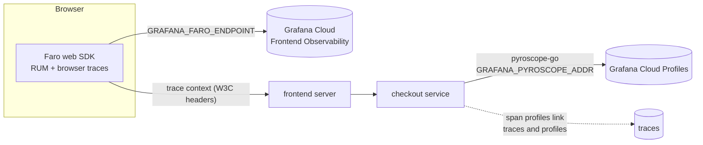

<!-- markdownlint-disable MD013 -->

# Faro browser monitoring and Pyroscope profiling

Two optional features ported from the Grafana fork of the demo. Both are **off
until you configure them** and both need the `frontend` and `checkout` images to be
built from this repository.

## Faro (browser real-user monitoring)

**What it adds** (`src/frontend`):

| Piece | File | Behavior |
|---|---|---|
| Initialization | `utils/telemetry/FaroTracer.ts` | Starts Faro with web instrumentations and browser tracing when `GRAFANA_FARO_ENDPOINT` is set. |
| Selection | `pages/_app.tsx` | If Faro started, the stock OpenTelemetry browser tracer (`FrontendTracer`) does **not** run; otherwise it does. They never run together, because both would instrument the same fetch/XHR calls. |
| Runtime config | `pages/_document.tsx`, `next.config.js` | The endpoint is read from the server environment at request time and handed to the browser as `window.ENV.NEXT_GRAFANA_FARO_ENDPOINT`. Production source maps are enabled so stack traces are readable. |
| Events | `utils/telemetry/FaroEvents.ts` and the pages | `page` events (Home, Cart, product, checkout), `add-to-cart`, `currency_select`, and a log line on currency selection. All helpers do nothing when Faro is not running. |
| Errors | `gateways/Api.gateway.ts` | Every failed API call is reported to Faro, in one place (the existing gateway proxy). |
| Demo error | `components/CheckoutForm/CheckoutForm.tsx` | Clicking **Place Order** reports a synthetic Faro error, `Order not visible enough`, so there is always an error to explore. Remove the `onClick` to turn it off. |
| Server timing | `middleware.ts` | Adds a `server-timing: traceparent` header so Faro can link the page load to the server trace. |

Package versions: `@grafana/faro-web-sdk` and `@grafana/faro-web-tracing`
**1.13.3**, chosen because they depend on the OpenTelemetry 1.30.x line this
frontend already pins (newer Faro releases pull a second, 2.x OpenTelemetry).

**Not ported:** the fork's change of the home-page banner text.

### Enable it

1. Grafana Cloud > **Frontend Observability** > **Create new** > copy the **Collector URL**.
2. In that app's settings add your site's origin to **Allowed origins** (for a local run: `http://localhost:8080`).
3. Put the URL in `.env.local` as `GRAFANA_FARO_ENDPOINT`.
4. Run `./start-local.sh --grafana-cloud` (or the Kubernetes equivalent) again.

## Pyroscope (continuous profiling of `checkout`)

`src/checkout/profiling.go` starts the Pyroscope Go agent. It runs only when
`GRAFANA_PYROSCOPE_ADDR` is set; a failure to start logs a warning and the
service keeps running. When enabled, spans carry profile IDs ("span profiles"),
so you can jump from a slow checkout trace to its flame graph. The application name in
Pyroscope is `checkout` (the fork used `checkoutservice`; the service was renamed upstream).

| Variable | Meaning |
|---|---|
| `GRAFANA_PYROSCOPE_ADDR` | Grafana Cloud > your stack > **Profiles** > **Details** > URL |
| `GRAFANA_PYROSCOPE_AUTH_USER` | the user shown there |
| `GRAFANA_PYROSCOPE_AUTH_PASS` | **secret**: a token with `profiles:write` |

Library versions: `pyroscope-go` 1.2.2 and `otel-profiling-go` 0.5.1 (the newest
releases force a bump of the core OpenTelemetry Go libraries, which this port avoids).

## Why the images must be built locally

The Compose file and the Helm chart reference prebuilt upstream images
(`ghcr.io/open-telemetry/demo:...-frontend`, `...-checkout`). Those contain no Faro
or Pyroscope code. So when either variable is set, `start-local.sh`:

- **Compose:** runs `docker compose build frontend checkout`; the rebuilt images take the upstream tags, so `up` uses them.
- **Kubernetes:** builds `workshop/frontend:local` and `workshop/checkout:local`, loads them into the cluster (minikube: `minikube image load`; OrbStack and Docker Desktop share the Docker image store) and points the chart at them through `components.<name>.imageOverride`.

Use `--no-build` to deploy the upstream images (Faro and Pyroscope then do nothing).

**Limitation:** on a cluster that cannot see your local Docker images (for
example EKS), the script keeps the upstream images and warns. To use the features
there, push `workshop/frontend` and `workshop/checkout` to a registry the cluster
can pull from and set `components.frontend.imageOverride` and
`components.checkout.imageOverride` in a values file. `deploy-aws.sh` does not do
this for you.

## Selective failure in `product-catalog`

When the pod name contains `product-catalog<N>` (for example `product-catalog2`),
the service also checks a feature flag called `fail-product-catalog<N>` besides the
existing `productCatalogFailure`. This lets you make only one of several deployments
fail. Details:

- The pod name comes from `OTEL_K8S_POD_NAME`. The chart does not set it, so `start-local.sh` adds it through the Kubernetes downward API.
- The flag must exist in the flagd configuration (`src/flagd/demo.flagd.json`); a flag that is not defined evaluates to `false`.
- The matching logic has a unit test: `cd src/product-catalog && go test -vet=off -run TestPodNamePattern .` (`-vet=off` because of unrelated upstream vet findings).
