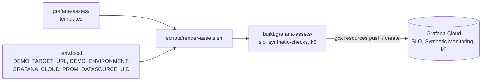

<!-- markdownlint-disable MD013 MD024 MD031 -->

# Grafana-side assets: SLOs, synthetic checks and k6 tests

Files under `grafana-assets/` describe things that live in your Grafana Cloud
stack. They are **templates**: `scripts/render-assets.sh` fills in your values and
writes ready-to-apply files to `build/grafana-assets/`. The script never contacts
Grafana Cloud.



## What is included

| Asset | Files | Notes |
|---|---|---|
| SLOs (4) | `slo/add-to-cart.yaml`, `browse-products.yaml`, `checkout.yaml`, `recommendation.yaml` | 99.9% over 28 days; PromQL success-rate queries; destination data source `GRAFANA_CLOUD_PROM_DATASOURCE_UID` |
| Synthetic checks (4) | `synthetic-checks/homepage.yaml`, `products.yaml`, `cart.yaml`, `checkout.yaml` | HTTP checks every 60 s against `DEMO_TARGET_URL` |
| k6 tests (4) | `k6/homepage.js`, `products.js`, `cart.js`, `checkout.js` | 10 virtual users for 30 s; thresholds p95 < 500 ms, failures < 1% |
| k6 schedules (4) | `k6/schedules/*.yaml` | every 6 h; `load_test_id: 0` is a placeholder: replace it with the ID k6 Cloud gives the test |

## Step by step

1. **Set the target.** In `.env.local` set `DEMO_TARGET_URL` to the address Grafana
   Cloud's probes can reach, e.g. `http://<load-balancer-hostname>:8080` (AWS) or a
   public tunnel to your laptop. `http://localhost:8080` works for k6 on your machine
   but **not** for synthetic checks (Grafana's probes run in the cloud).
   Optional: `DEMO_ENVIRONMENT` (label, default `workshop`) and
   `GRAFANA_CLOUD_PROM_DATASOURCE_UID` (default `grafanacloud-prom`; see Connections >
   Data sources > your Prometheus > the UID in the URL).
2. **Render.** `scripts/render-assets.sh`. Undo: `scripts/render-assets.sh --clean`.
3. **Verify the SLO queries (do not skip).** The queries use the collector's span metrics,
   `traces_span_metrics_calls_total`, filtered by `service_name="frontend"` and the span name
   of the route (`GET /api/products`, `POST /api/checkout`, ...). They returned a value on a
   live stack running this branch. The SDK metrics the original queries used
   (`http_server_duration_count`, `rpc_server_duration_count`) do not exist there, and metric
   names can differ in your stack. In Grafana Cloud > **Explore** > Prometheus data source, run
   for each SLO, for example:
   ```promql
   sum(rate(traces_span_metrics_calls_total{service_name="frontend",span_name=~"POST /api/checkout.*"}[5m]))
   ```
   A route only has data after it received requests (the load generator sends some). If you
   get **no data**, list the span names: `count by (span_name) (traces_span_metrics_calls_total{service_name="frontend"})`.
4. **Apply the SLOs** (preview first):
   ```bash
   gcx resources push slos.v1alpha1.slo.ext.grafana.app -p build/grafana-assets/slo --dry-run
   gcx resources push slos.v1alpha1.slo.ext.grafana.app -p build/grafana-assets/slo
   ```
   (`gcx login` first; or create the SLOs in the UI: **Alerts & IRM** > **SLO** > **Create SLO**
   and paste each query.)
5. **Apply the synthetic checks:** `gcx synthetic-monitoring checks create --help` shows
   the exact flags; create one check per file in `build/grafana-assets/synthetic-checks/`.
6. **Run the k6 tests** locally: `k6 run -e DEMO_TARGET_URL=http://localhost:8080 grafana-assets/k6/homepage.js`.
   To run them in Grafana Cloud k6: `gcx k6 load-tests create --help`.

## Changes compared with the original files

- `MINIKUBE_IP` and the hardcoded `localhost:8080` are replaced by `DEMO_TARGET_URL`.
- **Cart test and check:** sent `cartId`; the frontend handler (`pages/api/cart.ts`) reads
  `sessionId` and `currencyCode`. Fixed.
- **Checkout test:** placed an order without ever filling the cart. It now adds one item
  (`66VCHSJNUP`) first.
- **Synthetic checkout check:** tested against a running demo 2.0.2. The original body
  (`{"userId":"health-check"}`) returned **500**, so the check would have failed on every
  probe. It now sends a complete order, which returns 200, but every request records a real
  (empty) order and a Kafka event, so the check is shipped with `enabled: false`. Enable it
  only if one order per probe per minute is acceptable.
- **SLO queries:** moved from `http_server_duration_count` / `rpc_server_duration_count` (no data on this branch's stack) to span metrics; each was tested against live data. The recommendation SLO measures `GET /api/recommendations` as seen by the frontend, because the Python recommendation service emits no RPC metrics.
- SLO metadata names (the long IDs) are kept from the originals; they are opaque
  identifiers inside your stack.
