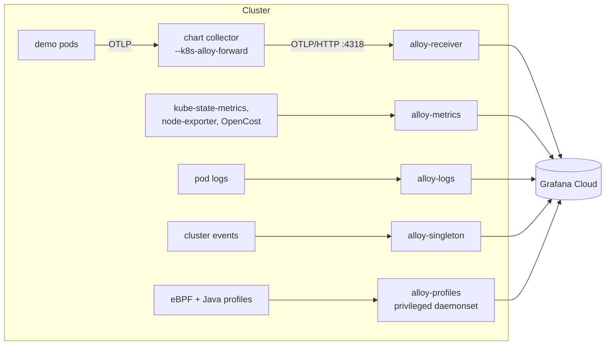
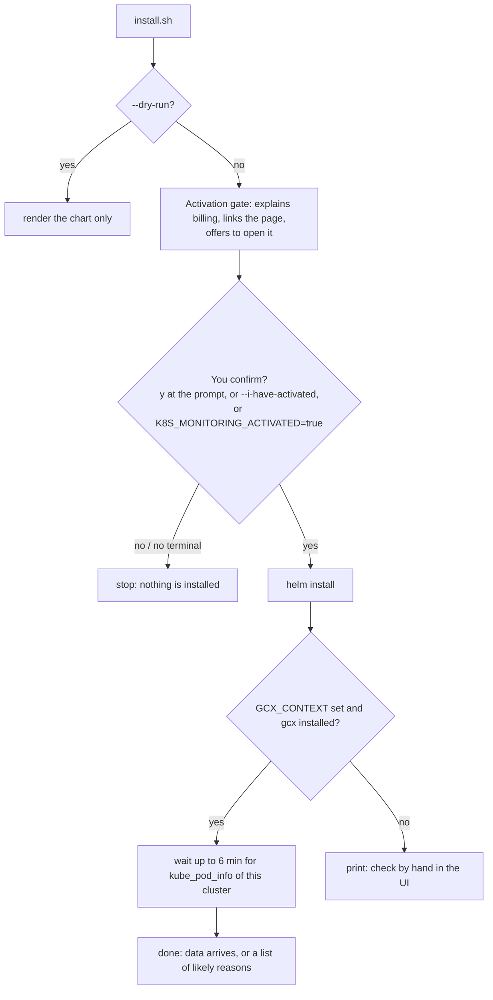

<!-- markdownlint-disable MD013 MD024 MD031 -->

# Grafana Cloud Kubernetes monitoring

`scripts/grafana-cloud-k8s-monitoring/install.sh` installs the
`grafana/k8s-monitoring` Helm chart so that the cluster itself (nodes, pods,
events, pod logs, costs, profiles) appears in Grafana Cloud. It also provides the
Alloy receiver that `./start-local.sh --k8s-alloy-forward` sends the demo's
telemetry to.



## Activation: one step only you can do

Grafana Cloud's Kubernetes Monitoring app stays empty until it is **activated** once, and a stack
that has not been activated shows only an "Activate Kubernetes Monitoring" panel on the app's
home page (`/a/grafana-k8s-app/home`). Activation is a billing decision: Kubernetes Monitoring is
billed on active host hours and active container hours, metered from `kube-state-metrics`, so
charges start when the cluster sends that data (see the
[pricing page](https://grafana.com/docs/grafana-cloud/platform/pricing-and-usage/kubernetes-monitoring/)).
**Grafana offers no API for activation** (the documentation describes only the UI, even for the
Helm and Terraform route), so no script can do it. What the installer does instead:



- **`--yes` does not answer the activation question.** A blanket "yes to prompts" must not acknowledge
  billing. Outside a terminal, use `--i-have-activated` (or `K8S_MONITORING_ACTIVATED=true`).
- **Click path for you:** open the stack (My Account > stack > Details > **Launch** for Kubernetes
  Monitoring, or `GRAFANA_STACK_URL/a/grafana-k8s-app/home`), click **Activate**, tick the box in the dialog,
  click **Activate**. The installer is the "Start sending data" step.
- **Verification is explicit about which stack it reads.** The data check uses `GCX_CONTEXT` only
  (`gcx --context <it> metrics query ...`) and prints the stack it is reading; with no `GCX_CONTEXT` it
  skips the check and tells you to look in Kubernetes > Cluster navigation.

## Prerequisites

| Need | How |
|---|---|
| A running cluster and its kubectl context | see [deployment-guide.md](deployment-guide.md#3-prerequisites) |
| `helm` and `kubectl` | `brew install helm kubectl` |
| The values below in `.env.local` | table below |

**Shortcut for the six URL and user values.** If you have `gcx`, run `gcx cloud login` (with the
context of this stack) and set `GCX_CONTEXT=<that context>` in `.env.local`. The installer then
reads the stack with `gcx cloud stacks get` and fills every value below that you left unset, except
the token, which only you can create. It prints which values it filled; values you set are never
overwritten. Two details learned the hard way: `gcx cloud login` saves the login under the context
you are in, so use the same `--context` afterwards; and the installer runs `gcx` without the
`GRAFANA_CLOUD_TOKEN` variable, because `gcx` treats that variable as its own cloud API token and
then rejects its login (HTTP 401).

| Variable | Where to find it, click by click |
|---|---|
| `GRAFANA_CLOUD_TOKEN` (**secret**) | grafana.com > your org > **Access Policies** > **Create access policy**, realm: your stack, scopes `metrics:write`, `logs:write`, `traces:write`, `profiles:write` > **Create** > **Add token** > copy it (`glc_...`) |
| `GRAFANA_OTLP_ENDPOINT`, `GRAFANA_INSTANCE_ID` | stack **Details** > OpenTelemetry > **Configure** |
| `GRAFANA_CLOUD_METRICS_URL`, `GRAFANA_CLOUD_METRICS_USER` | stack **Details** > **Prometheus** > **Send Metrics**: URL ending in `/api/prom/push` and the numeric user |
| `GRAFANA_CLOUD_LOGS_URL`, `GRAFANA_CLOUD_LOGS_USER` | stack **Details** > **Loki** > URL ending in `/loki/api/v1/push` and the user |
| `GRAFANA_CLOUD_PROFILES_URL`, `GRAFANA_CLOUD_PROFILES_USER` | stack **Details** > **Pyroscope** > URL (with `:443`) and the user |

Optional: `GRAFANA_STACK_URL`, `GCX_CONTEXT`, `K8S_MONITORING_ACTIVATED`, `K8S_MONITORING_VERIFY_MINUTES` (see
[configuration.md](configuration.md)), `K8S_CLUSTER_NAME` (default: the kubectl context), `K8S_MONITORING_CHART_VERSION`
(default `4.6.0`), `K8S_MONITORING_NAMESPACE` and `K8S_MONITORING_RELEASE` (both default
`grafana-k8s-monitoring`), `K8S_CONTEXT`.

## 1-click

```bash
scripts/grafana-cloud-k8s-monitoring/install.sh --dry-run    # renders the chart, changes nothing
scripts/grafana-cloud-k8s-monitoring/install.sh              # installs
```

The script: loads the configuration and stops with instructions for anything
missing; checks the cluster is reachable; renders `values.yaml.tmpl` to
`build/k8s-monitoring-values.yaml`; writes the token to a temporary `0600` values
file (so it never appears in the process list) and deletes it on exit; adds the
`grafana` Helm repo; runs `helm upgrade --install ... --atomic --timeout 10m`; prints the
pod status and the next steps.

Options: `--cluster-name`, `--context`, `--i-have-activated`, `--no-verify`, `--verify-minutes N`, `--uninstall`, `--dry-run`, `--yes`, `--help`.

## Manual equivalent

1. Copy `scripts/grafana-cloud-k8s-monitoring/values.yaml.tmpl` to a file, for
   example `my-values.yaml`, and replace each `${...}` with the values from the table.
   `${GRAFANA_CLOUD_METRICS_QUERY_URL}` is the metrics URL without the trailing `/push`.
2. Create `my-secrets.yaml` (do not commit it) with the token in the five places the
   chart needs it:
   ```yaml
   destinations:
     grafana-cloud-metrics:  {auth: {password: "glc_..."}}
     grafana-cloud-logs:     {auth: {password: "glc_..."}}
     gc-otlp-endpoint:       {auth: {password: "glc_..."}}
     grafana-cloud-profiles: {auth: {password: "glc_..."}}
   collectorCommon:
     alloy:
       remoteConfig: {auth: {password: "glc_..."}}
   ```
3. Install:
   ```bash
   helm repo add grafana https://grafana.github.io/helm-charts && helm repo update
   helm upgrade --install grafana-k8s-monitoring grafana/k8s-monitoring --version 4.6.0 \
     --namespace grafana-k8s-monitoring --create-namespace \
     -f my-values.yaml -f my-secrets.yaml \
     --set-string cluster.name=<cluster-name> \
     --set-string telemetryServices.opencost.opencost.exporter.defaultClusterId=<cluster-name> \
     --set-string telemetryServices.opencost.opencost.prometheus.existingSecretName=grafana-cloud-metrics-grafana-k8s-monitoring \
     --atomic --timeout 10m
   ```

## Verify

```bash
kubectl get pods -n grafana-k8s-monitoring            # all Running after 1-2 minutes
kubectl logs -n grafana-k8s-monitoring -l app.kubernetes.io/name=alloy --tail=30
```
Then Grafana Cloud > **Kubernetes** > **Cluster navigation**: your cluster name appears.

## Undeploy and decommission

```bash
scripts/grafana-cloud-k8s-monitoring/install.sh --uninstall
kubectl delete namespace grafana-k8s-monitoring       # optional, for a clean slate
```

`--uninstall` removes the release (the collectors), then explains the billing side. Once no
`kube-state-metrics` arrive, hosts and containers stop counting as active (the docs define active as
"reported within the last 15 minutes"), so usage stops accruing on its own. **Activation stays on.**
Switching the app off is also UI-only and does not delete any metrics: your stack >
Kubernetes > **Configuration** > **Manage app** > **Deactivate**. The script prints that path (with your
`GRAFANA_STACK_URL` link when set) but never deactivates anything itself.

## Design decisions

- **Chart pinned to 4.6.0.** The original `^4` range now resolves to a chart that
  rejects `profiling.enabled: true` without a profile type (older charts silently
  collected nothing). The values enable the eBPF and Java profilers explicitly. The template renders with
  4.0.5, 4.1.7, 4.3.3, 4.5.5 and 4.6.0.
- **Token never on a command line.** The previous version passed it with `--set-string`,
  which is visible in `ps`.
- **Fleet-management remote config is off.** Enabling it needs the extra scopes
  `fleet-management:read` and `fleet-management:write` on the access policy.
- **Tested without a cluster:** `scripts/tests/k8s-monitoring-test.sh` covers the gate (including that `--yes` does not pass it), the data check with a fake `gcx`, and the decommission note. The data check was also run against a real stack with `gcx`.
- **Not verified at runtime.** The chart creates the Alloy workloads through the
  Alloy operator at install time, so the receiver Service
  `<release>-alloy-receiver` can only be confirmed on a live cluster.
