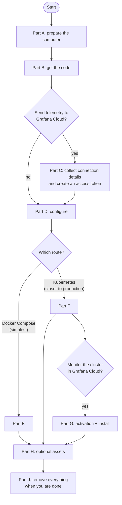
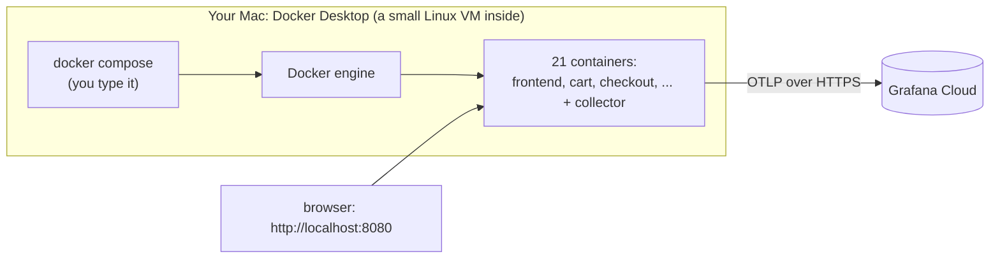
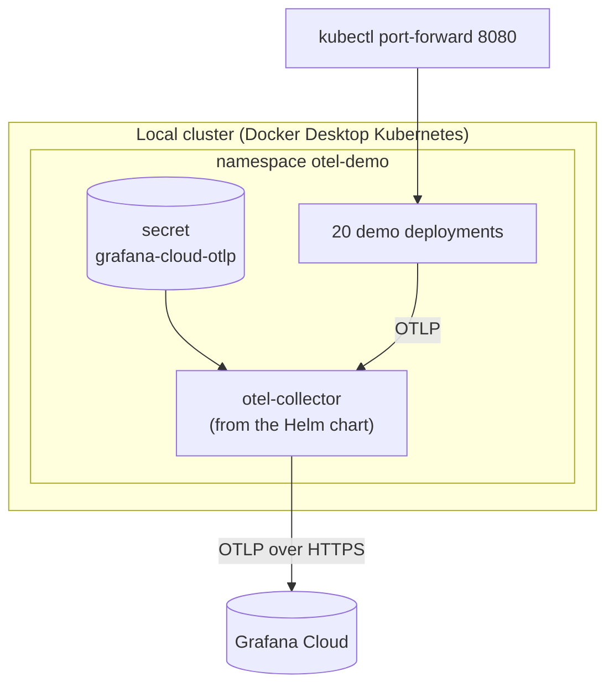
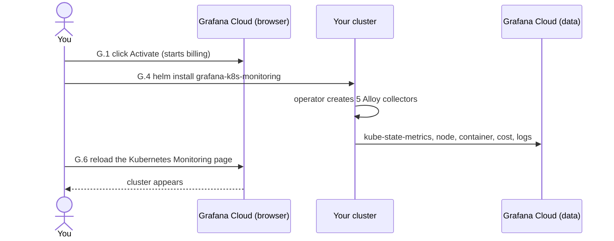

<!-- markdownlint-disable MD013 MD024 MD031 MD033 -->

# Manual deployment guide (step by step, no 1-click scripts)

**Audience:** someone with little experience who has to deploy the OpenTelemetry Demo, send its
telemetry to Grafana Cloud, and (optionally) monitor the Kubernetes cluster, **by hand**, one
step at a time, and understand what each step does.

**How this document works.** Every step has three parts: **Do** (exactly what to click or type),
**Expect** (what you should see) and **If not** (what to check). Do the steps in order and do not
skip the "Expect" checks: most problems show up in the step *before* the one that fails.

**The 1-click alternative.** Everything here is also automated by the scripts described in
[deployment-guide.md](deployment-guide.md). Each script prints which part of *this* document is the
manual equivalent of what it was doing, so you can switch between the two at any point.

> **About the portal screens.** Grafana changes its web interface. The click paths below come from
> Grafana's own documentation and from what was seen while building this branch (2026-11-09). If a
> button has a slightly different name, look for the closest one. Where a click path is **not**
> confirmed, the text says so.

## Contents

- [0. Choose what you are going to do](#0-choose-what-you-are-going-to-do)
- [Part A. Prepare your computer](#part-a-prepare-your-computer)
- [Part B. Get the code](#part-b-get-the-code)
- [Part C. Grafana Cloud: collect your connection details](#part-c-grafana-cloud-collect-your-connection-details)
- [Part D. Configure the workshop](#part-d-configure-the-workshop)
- [Part E. Route 1: Docker Compose](#part-e-route-1-docker-compose)
- [Part F. Route 2: local Kubernetes](#part-f-route-2-local-kubernetes)
- [Part G. Monitor the Kubernetes cluster itself](#part-g-monitor-the-kubernetes-cluster-itself)
- [Part H. SLOs, synthetic checks and k6 tests](#part-h-slos-synthetic-checks-and-k6-tests)
- [Part I. AWS](#part-i-aws)
- [Part J. Remove everything](#part-j-remove-everything)
- [Part K. Troubleshooting](#part-k-troubleshooting)
- [Appendix. Words used in this guide](#appendix-words-used-in-this-guide)

---

## 0. Choose what you are going to do



| You want | Do these parts |
|---|---|
| See the shop running, nothing sent anywhere | A, B, D (skip C), E with mode **vanilla** |
| Shop + telemetry in Grafana Cloud (recommended first goal) | A, B, C, D, E with mode **grafana-cloud** |
| The same on Kubernetes | A, B, C, D, F |
| Cluster monitoring page in Grafana Cloud | everything for Kubernetes, then G |
| Browser monitoring (Faro) or profiling (Pyroscope) | add the optional steps marked **[Faro]** and **[Pyroscope]** |

**Time:** Part A about 30 minutes (mostly downloads), B 5, C 15, D 10, E 15 (first start downloads about
3 to 5 GB), F 20, G 20.

**Money:** Parts A to F on a local computer cost nothing except a Grafana Cloud account (the free tier is
enough for E and F). **Part G starts billing** in Grafana Cloud (see G.1). **Part I creates paid AWS resources.**

---

## Part A. Prepare your computer

This part is written for macOS (Apple Silicon or Intel). On Linux, install the same tools with your
package manager.

### A.1 Open a terminal

**Do:** press `Cmd + Space`, type `Terminal`, press `Enter`.
**Expect:** a window with a prompt, such as `yourname@your-mac ~ %`.
All commands in this guide are typed in this window, one block at a time. Lines starting with `#` are
comments: you do not type them.

### A.2 Install Homebrew (the tool installer)

**Do:** check first: `brew --version`.
**Expect:** a version number. If you see `command not found`, install it from <https://brew.sh> by pasting the single command shown on that page, then close and reopen the terminal.

### A.3 Install Docker Desktop

**Do:**

1. Open <https://www.docker.com/products/docker-desktop/>, download the version for your chip (Apple Silicon or Intel) and open the downloaded `.dmg`.
2. Drag **Docker** into **Applications**, open it from Applications and accept the license.
3. Wait until the whale icon in the menu bar stops animating and the Docker window says the engine is running.

**Expect:** in the terminal, `docker info` prints a long text with no error, and `docker compose version` prints `Docker Compose version v2...` or newer.
**If not:** `Cannot connect to the Docker daemon` means Docker Desktop is not running yet; wait one minute or start it again.

> If you also have OrbStack installed, quit one of the two: they compete for the same Docker socket.

### A.4 Give Docker enough memory

**Do:** Docker Desktop > the gear icon (**Settings**) > **Resources** > set **Memory** to **8 GB or more** (16 GB is comfortable) and **CPUs** to 4 or more > **Apply & restart**.
**Expect:** `docker info --format '{{.MemTotal}}'` prints a number of at least `8000000000`.
**Why:** about 20 services run at once; with less memory some are killed and restart in a loop.

### A.5 (Kubernetes route only) enable Kubernetes in Docker Desktop

**Do:** Docker Desktop > **Settings** > **Kubernetes** > tick **Enable Kubernetes** > **Apply & restart**. The first start downloads images and takes a few minutes; the Kubernetes status at the bottom of the Docker window turns green.
**Expect:**
```bash
kubectl config get-contexts
```
shows a line named `docker-desktop`, and
```bash
kubectl --context docker-desktop get nodes
```
shows one node with `STATUS Ready`.
**If not:** wait until Docker Desktop reports Kubernetes as running, then retry. (Alternatives to Docker Desktop's Kubernetes: minikube, or OrbStack's Kubernetes; the commands below then use `minikube` or `orbstack` instead of `docker-desktop`.)

### A.6 Install the command-line tools

**Do:**
```bash
brew install git kubectl helm
```
Optional but useful: `brew install yq` (reads YAML) and `brew install gcx` (Grafana's command-line client, if it is available in your Homebrew; otherwise follow Grafana's installation instructions).
**Expect:** each of these prints a version:
```bash
git --version
kubectl version --client
helm version
```
**Note:** `helm` 3 and 4 both work for this guide. The only difference you will meet is the name of one flag, explained in G.4.

### A.7 Checklist

| Check | Command | Expected |
|---|---|---|
| Docker running | `docker info` | no error |
| Compose v2 | `docker compose version` | `v2` or newer |
| Memory | `docker info --format '{{.MemTotal}}'` | at least `8000000000` |
| (Kubernetes) cluster | `kubectl --context docker-desktop get nodes` | one node `Ready` |
| helm | `helm version` | a version |

---

## Part B. Get the code

### B.1 Clone the repository and switch to the workshop branch

**Do:**
```bash
cd ~
git clone https://github.com/rnp68/opentelemetry-demo.git
cd opentelemetry-demo
git checkout workshop
```
(If you already have the repository on your computer, only `cd` into it and run `git checkout workshop`.)
**Expect:** `Switched to branch 'workshop'`, and
```bash
git branch --show-current
```
prints `workshop`.
**If not:** `pathspec 'workshop' did not match` means the branch is not on that remote yet. Ask the person who gave you the repository to push it, or work in the local copy where it exists.

**Important:** every command from here on is typed **inside this folder** (`~/opentelemetry-demo`). If a command says `No such file or directory` for a file name like `docker-compose.yml`, you are in the wrong folder: run `cd ~/opentelemetry-demo`.

### B.2 Look around (optional)

```bash
ls
```
You should see, among others: `docker-compose.yml`, `docker-compose.grafana-cloud.yml`, `kubernetes/`, `scripts/`, `docs/`, `grafana-assets/`, `.env.example`.

---

## Part C. Grafana Cloud: collect your connection details

Skip this whole part if you only want to run the shop with **no** telemetry destination (Part E, mode `vanilla`).

You need a Grafana Cloud account and one **stack** (a Grafana Cloud environment). The free tier is
enough: create an account at <https://grafana.com/auth/sign-up/create-user>.

### C.1 Sign in and find your stack

**Do:**

1. Open <https://grafana.com> and click **Sign in**.
2. Click **My Account** (top right). You see your organization and your stacks.
3. Next to your stack, click **Details** (or the stack's name). Write down the stack's address, for example `https://myname.grafana.net`: you will use it as `GRAFANA_STACK_URL` later.

**Expect:** a page for the stack listing products such as Grafana, Prometheus, Loki, Tempo and Profiles.

### C.2 Find the OTLP endpoint and the instance ID

These two values tell the collector where to send telemetry and who it is.

**Do (route 1, documented by Grafana):** sign in to the stack's Grafana (click **Launch** on the Grafana tile) > **Connections** (or **Add new connection**) > search for **OpenTelemetry** > open the OpenTelemetry tile and follow its instructions. The page shows the **OTLP endpoint** (looks like `https://otlp-gateway-prod-us-east-2.grafana.net/otlp`) and the **Instance ID** (a number).

**Do (route 2, with `gcx`):** if you use the `gcx` client and have run `gcx cloud login`:
```bash
gcx --context <your-context> cloud stacks get <your-stack-slug>
```
In the output, `id` is the instance ID, and the OTLP endpoint is `https://otlp-gateway-<clusterSlug>.grafana.net/otlp` where `clusterSlug` is shown in the same output (for example `prod-us-east-2`).

**Write down:**

| What | Looks like | Goes into |
|---|---|---|
| OTLP endpoint | `https://otlp-gateway-prod-us-east-2.grafana.net/otlp` | `GRAFANA_OTLP_ENDPOINT` |
| Instance ID | `1234567` | `GRAFANA_INSTANCE_ID` |

> The **endpoint ends in `/otlp`** and has **no spaces**. The instance ID is **digits only**.

### C.3 Create the access policy and the token

The collector proves who it is with a **token**. Create it **from inside your stack**, so it is created
for that stack (Grafana's documented path; tokens created from the organization-level page behaved
differently during testing and are best avoided).

**Do:**

1. Sign in to Grafana Cloud and **open (Launch) your stack**.
2. In the left menu click **Administration** > **Cloud access policies**.
3. Click **Create access policy**.
4. **Display Name:** type a name, for example `otel-demo-workshop`.
5. **Scopes:** select the scopes in the table below. If a scope is not listed, use the **Add scope** drop-down near the bottom of the dialog.
6. Click **Create**.
7. On the new policy click **Add token**, type a **token name** (for example `otel-demo-workshop-token`), choose an expiry, click **Create**, and **copy the token immediately**: it starts with `glc_` and is shown **only once**.

**Scopes to select:**

| Scope | Needed for |
|---|---|
| `metrics:write`, `logs:write`, `traces:write` | sending the demo's telemetry (Parts E and F) |
| `profiles:write` | Pyroscope profiling **[Pyroscope]** and cluster profiling (Part G) |
| `metrics:read` | **required for Part G**: OpenCost reads metrics back; without it the cluster-monitoring install fails after 10 minutes |
| `logs:read`, `traces:read`, `profiles:read` | optional; harmless; useful for checks with `gcx` |

> One token with all eight scopes is the simplest for a workshop. For production, use separate policies with only the scopes each needs.

**Expect:** you now hold one long text starting with `glc_`.

**Do not:**

- paste the token into chat, email, a ticket or a Git commit;
- add a scope to an existing policy and expect an **old** token to pick it up: it did not during testing. **Create a new token** on the policy after changing its scopes.

### C.4 Copy the token without damaging it

Copy mistakes were the single most common failure while building this branch (a stray extra letter in front of the token made every request fail with `invalid token`).

**Do:** after you paste the token somewhere, check it:

- it starts with exactly `glc_` (not `gglc_`, and with no space in front);
- it is one line with no spaces;
- in the check in C.5 below it is accepted.

### C.5 Test the token before using it

This sends three harmless requests. Replace the three values and paste the block into the terminal. The token is read silently so it is not stored in your shell history.

```bash
read -rs GC_TOKEN        # paste the token, press Enter (nothing is shown while you paste)
GC_ID=1234567            # your instance ID from C.2
GC_OTLP=https://otlp-gateway-prod-us-east-2.grafana.net/otlp   # your endpoint from C.2

printf 'user = "%s:%s"\n' "$GC_ID" "$GC_TOKEN" | \
  curl -sS -K - -o /dev/null -w 'OTLP traces: HTTP %{http_code}\n' \
  -X POST -H 'Content-Type: application/json' -d '{}' "$GC_OTLP/v1/traces"
```

**Expect:** `OTLP traces: HTTP 200`.
**If not:**

| You see | Meaning | Fix |
|---|---|---|
| `HTTP 401` | wrong instance ID, wrong or damaged token, or the token was not created in this stack | re-check C.2 and C.4; create a new token (C.3) |
| `HTTP 403` | token valid but missing a scope | add `metrics:write`, `logs:write`, `traces:write` and create a new token |
| `HTTP 000` or `Could not resolve host` | typo in the endpoint, or no internet | re-copy the endpoint |

When you are done: `unset GC_TOKEN`.

### C.6 [Faro] Browser monitoring collector URL (optional)

**Do:** in your stack's Grafana, open **Frontend Observability** (left menu or the Connections page), create a new application, and copy the **collector URL** it shows. In that application's settings, add the origin of your site (for a local run `http://localhost:8080`) to the **allowed origins**.
**Note:** the exact screen names for this step were **not confirmed** in this session; use Grafana's Frontend Observability "Get started" documentation if a label differs.
**Goes into:** `GRAFANA_FARO_ENDPOINT`.

### C.7 [Pyroscope] Profiles URL and user (optional)

**Do:** My Account > your stack > **Details** > the **Pyroscope / Profiles** section: copy the **URL** (for example `https://profiles-prod-001.grafana.net`) and the **user** (a number). The password is a token with `profiles:write` (the one from C.3 works).
**Goes into:** `GRAFANA_PYROSCOPE_ADDR` (URL), `GRAFANA_PYROSCOPE_AUTH_USER`, `GRAFANA_PYROSCOPE_AUTH_PASS`.

---

## Part D. Configure the workshop

All configuration lives in one file you create: `.env.local`. It is private (Git ignores it) and
never committed. The file `.env.example` is the template.

### D.1 Create `.env.local`

**Do:**
```bash
cp .env.example .env.local
chmod 600 .env.local
```
**Expect:** `ls -l .env.local` shows `-rw-------`.

### D.2 Edit `.env.local`

**Do:** open it in a text editor, for example `open -e .env.local` (TextEdit) or `code .env.local` (VS Code).
Every value starts as `unknown`, which means "not set". Replace `unknown` only for what you need:

| Goal | Variables to set |
|---|---|
| Shop only (mode vanilla) | none |
| Telemetry to Grafana Cloud (Parts E, F) | `GRAFANA_OTLP_ENDPOINT`, `GRAFANA_INSTANCE_ID`, `GRAFANA_CLOUD_APIKEY` |
| **[Faro]** | `GRAFANA_FARO_ENDPOINT` |
| **[Pyroscope]** | `GRAFANA_PYROSCOPE_ADDR`, `GRAFANA_PYROSCOPE_AUTH_USER`, `GRAFANA_PYROSCOPE_AUTH_PASS` |
| Part G (cluster monitoring) | `GRAFANA_CLOUD_TOKEN` (same token if it has all scopes), `GRAFANA_CLOUD_METRICS_URL`, `GRAFANA_CLOUD_METRICS_USER`, `GRAFANA_CLOUD_LOGS_URL`, `GRAFANA_CLOUD_LOGS_USER`, `GRAFANA_CLOUD_PROFILES_URL`, `GRAFANA_CLOUD_PROFILES_USER` (found in G.2) |
| Part H | `DEMO_TARGET_URL` |

**Rules for the file:**

- one `KEY=value` per line, **no space after the `=`**, and the value is **one word** (no spaces);
- if a value has spaces, put it in quotes;
- put nothing after the value except an optional `# comment` that is **separated by a space**;
- leave lines you do not need as `unknown`;
- never put the file anywhere public.

Example of the three lines for Part E (yours will differ):
```text
GRAFANA_OTLP_ENDPOINT=https://otlp-gateway-prod-us-east-2.grafana.net/otlp
GRAFANA_INSTANCE_ID=1234567
GRAFANA_CLOUD_APIKEY=glc_............   # the full token, one line
```

### D.3 Check what is set (this deploys nothing)

**Do:**
```bash
scripts/make-env.sh --check
```
**Expect:** a list of every variable with `not set`, the value, or `set (NNN chars)` for secrets. Confirm:

- `GRAFANA_OTLP_ENDPOINT` shows the endpoint, with nothing after it;
- `GRAFANA_INSTANCE_ID` shows digits only;
- `GRAFANA_CLOUD_APIKEY` shows `set (212 chars)` or a similar length: **a token of 213 characters or one not starting with `glc_` is damaged**.

**If not:** the line `! .env.local: ignored extra text after the value of X` means there is text after a value; remove it.

### D.4 Create the file Docker Compose will read

**Why this step exists:** Docker Compose must **not** read `.env.local` directly. That file contains the placeholder `unknown` and comments; Compose would pass the literal word `unknown` to the containers (for example it would make Faro and Pyroscope try to start with an address called "unknown"). This helper writes a clean file with the placeholders removed and the defaults filled in.

**Do:**
```bash
scripts/make-env.sh
```
**Expect:** `Wrote build/env.resolved (mode 0600)`.
You can open `build/env.resolved` to see it: only `KEY='value'` lines, no `unknown`. It contains your token: **do not share it**. It is git-ignored and is rewritten every time you run the helper (run it again after every change to `.env.local`).

> **Fully by hand (no helper):** create `build/env.resolved` yourself with `mkdir -p build`, then write one `KEY='value'` line per value you set, plus `DEMO_VERSION='2.0.2'` (explained in K.4). Use single quotes. Nothing else is needed.

---

## Part E. Route 1: Docker Compose

Docker Compose starts all demo services as containers on your computer, using the files in the
repository. Pick **one mode**:

| Mode | Command part `-f ...` | What runs | Needs Grafana values |
|---|---|---|---|
| full (upstream) | *(none)* | demo + Jaeger + Prometheus + Grafana + OpenSearch | no |
| **grafana-cloud** | `-f docker-compose.yml -f docker-compose.grafana-cloud.yml` | demo + collector that sends to Grafana Cloud; **no** local backends (about 1.8 GB lighter) | **yes** |
| vanilla | `-f docker-compose.yml -f docker-compose.vanilla.yml` | demo + a collector that drops everything | no |
| no-otel | `-f docker-compose.yml -f docker-compose.no-otel.yml` | demo with telemetry disabled, backend screens still run | no |

The examples use **grafana-cloud**; replace the `-f` part for another mode.



### E.1 Make sure nothing else is using the names

The demo's containers have fixed names (`frontend`, `kafka`, `load-generator`, ...). A **stopped** container from another project with the same name blocks the start with `container name "/xyz" is already in use`.

**Do:**
```bash
docker ps -a --format '{{.Names}}  {{.Status}}  {{.Label "com.docker.compose.project"}}'
```
**Expect:** no container named like the demo services, or only ones belonging to project `opentelemetry-demo`.
**If you find a stale one:** see K.5. Do **not** delete containers you do not recognize.

### E.2 [Faro / Pyroscope] build the two images that contain the extra code

Skip this step if you use neither Faro nor Pyroscope. The published demo images do **not** contain the Faro and Pyroscope code, so they must be built from this repository first.

**Do:**
```bash
docker compose --env-file .env --env-file build/env.resolved \
  -f docker-compose.yml -f docker-compose.grafana-cloud.yml \
  build frontend checkout
```
**Expect:** a few minutes of build output ending without errors. The images take the same names as the published ones, so the next step uses them.

### E.3 Start the demo

**Do:**
```bash
docker compose --env-file .env --env-file build/env.resolved \
  -f docker-compose.yml -f docker-compose.grafana-cloud.yml \
  up --force-recreate --remove-orphans --detach
```
**Expect:** a long list of lines ending with `Container ... Started`. The **first** start downloads about 3 to 5 GB and can take 10 minutes or more. Docker Desktop's **Containers** list now shows a group `opentelemetry-demo`.

**What the options mean:** `--env-file` files are read in order (later wins); `-f` files are layered on top of each other; `--force-recreate` replaces existing containers; `--detach` returns your terminal.

### E.4 Wait until it is healthy

**Do:**
```bash
docker compose --env-file .env --env-file build/env.resolved \
  -f docker-compose.yml -f docker-compose.grafana-cloud.yml ps
```
**Expect:** 21 services with State `running` (and `kafka` showing `healthy`). None should be `restarting` or `exited`. If one is, see K.

### E.5 Open the shop

**Do:** in a browser open <http://localhost:8080>.
**Expect:** the Astronomy Shop home page. Also open:

| Page | Address |
|---|---|
| Load generator (simulated shoppers) | <http://localhost:8080/loadgen/> |
| Feature flags (switch failures on and off) | <http://localhost:8080/feature> |

### E.6 Check that the collector is sending

**Do:**
```bash
docker logs otel-collector 2>&1 | grep -ci 'Exporting failed'
```
**Expect:** `0`. **If not:** read the errors:
```bash
docker logs otel-collector 2>&1 | grep 'Exporting failed' | tail -3
```
`HTTP Status Code 401` means a credential problem (go back to C.3 to C.5, then D.4, then restart with E.3).

### E.7 See your data in Grafana Cloud (wait about 2 minutes first)

**Do:** open your stack's Grafana > **Explore** (compass icon) > choose the data source whose name ends in **traces** (`grafanacloud-<stack>-traces`) > switch to the **Search** or **TraceQL** tab and run:
```text
{ resource.service.namespace = "opentelemetry-demo" }
```
**Expect:** a list of traces from `frontend`, `frontend-proxy`, `cart`, `product-catalog` and others.
For metrics choose the data source ending in **prom** and run `count by (service_name) ({service_namespace="opentelemetry-demo"})`; you should see about 17 services. For logs choose the **logs** data source and run `{service_namespace="opentelemetry-demo"}`.

### E.8 Stop

```bash
docker compose --env-file .env --env-file build/env.resolved \
  -f docker-compose.yml -f docker-compose.grafana-cloud.yml \
  --profile local-backends --profile tests --profile odd \
  down --remove-orphans --volumes
```
**Expect:** `Container ... Removed` lines and `Network opentelemetry-demo Removed`.

---

## Part F. Route 2: local Kubernetes

Here the demo runs as Kubernetes workloads installed with **Helm** (a package manager for Kubernetes). The
cluster pulls the demo images itself.



Replace `docker-desktop` with `minikube` or `orbstack` if you use those.

### F.1 Choose the cluster and keep it explicit

**Do:**
```bash
kubectl config get-contexts
kubectl --context docker-desktop get nodes
```
**Expect:** the node is `Ready`.
**Why `--context` everywhere:** your *current* context may be a different cluster (even a cloud one). Writing `--context docker-desktop` in every command means you can never deploy to the wrong cluster by accident.

### F.2 Add the Helm repository

```bash
helm repo add open-telemetry https://open-telemetry.github.io/opentelemetry-helm-charts
helm repo update
```
**Expect:** `"open-telemetry" has been added` (or already exists) and `Update Complete`.

### F.3 Create the namespace

```bash
kubectl --context docker-desktop create namespace otel-demo
```
**Expect:** `namespace/otel-demo created`. (`AlreadyExists` is fine.)

### F.4 Store your Grafana credentials in a Kubernetes secret

The secret keeps the token out of every values file. Paste the token when asked (it is not shown).

```bash
read -rs GC_TOKEN
kubectl --context docker-desktop -n otel-demo create secret generic grafana-cloud-otlp \
  --from-literal=GRAFANA_OTLP_ENDPOINT='https://otlp-gateway-prod-us-east-2.grafana.net/otlp' \
  --from-literal=GRAFANA_INSTANCE_ID='1234567' \
  --from-literal=GRAFANA_CLOUD_APIKEY="$GC_TOKEN"
unset GC_TOKEN
```
(Use **your** endpoint and instance ID.)
**Expect:** `secret/grafana-cloud-otlp created`.
**If you must redo it:** `kubectl --context docker-desktop -n otel-demo delete secret grafana-cloud-otlp`, then run the block again.

### F.5 Create a small extras file

This file adds one setting the chart does not provide: the pod name, needed by the "selective failure" feature of `product-catalog`. It can also hold **[Faro]** and **[Pyroscope]** settings.

**Do:** create the file `build/values-extras.yaml`:
```bash
mkdir -p build
cat > build/values-extras.yaml <<'EOF'
components:
  product-catalog:
    envOverrides:
      - name: OTEL_K8S_POD_NAME
        valueFrom:
          fieldRef:
            fieldPath: metadata.name
EOF
```
**Expect:** `cat build/values-extras.yaml` prints the text above.

**Rule when you edit it:** under `components:`, write a component (such as `frontend:`) **only if you give it content**. An empty `frontend:` line means "delete this component" in Helm and would remove the shop's frontend.

**[Faro] and [Pyroscope] additions** (only if you use them; they also need the images from F.6):
```yaml
components:
  product-catalog:
    envOverrides:
      - name: OTEL_K8S_POD_NAME
        valueFrom: {fieldRef: {fieldPath: metadata.name}}
  frontend:
    imageOverride: {repository: workshop/frontend, tag: local, pullPolicy: IfNotPresent}
    envOverrides:
      - name: GRAFANA_FARO_ENDPOINT
        value: "https://faro-collector.example/collect/abc"     # your Faro URL
  checkout:
    imageOverride: {repository: workshop/checkout, tag: local, pullPolicy: IfNotPresent}
    envOverrides:
      - name: GRAFANA_PYROSCOPE_ADDR
        value: "https://profiles-prod-001.grafana.net"          # your Profiles URL
      - name: GRAFANA_PYROSCOPE_AUTH_USER
        value: "1234567"                                        # your Profiles user
      - name: GRAFANA_PYROSCOPE_AUTH_PASS
        valueFrom: {secretKeyRef: {name: grafana-cloud-pyroscope, key: GRAFANA_PYROSCOPE_AUTH_PASS}}
```
and create that second secret first:
```bash
read -rs GC_TOKEN
kubectl --context docker-desktop -n otel-demo create secret generic grafana-cloud-pyroscope \
  --from-literal=GRAFANA_PYROSCOPE_AUTH_PASS="$GC_TOKEN"
unset GC_TOKEN
```

### F.6 [Faro / Pyroscope] build the two images and give them to the cluster

Skip if you use neither.
```bash
docker build -f src/frontend/Dockerfile -t workshop/frontend:local .
docker build -f src/checkout/Dockerfile -t workshop/checkout:local .
```
**Expect:** both builds end without errors.
**Docker Desktop's and OrbStack's Kubernetes** see these local images directly. **minikube** needs `minikube image load workshop/frontend:local` and the same for `checkout`. A cluster on another machine (for example AWS) cannot see local images: push them to a registry it can pull from and put that registry in `imageOverride.repository`.

### F.7 Install the demo

Pick the mode by choosing the values files (the first one is always `values-local.yaml`):

| Mode | Add these `-f` files after `values-local.yaml` |
|---|---|
| **grafana-cloud** | `-f kubernetes/values-grafana-cloud.yaml` |
| vanilla (noop collector) | `-f kubernetes/values-vanilla.yaml` |
| clean (no collector) | `-f kubernetes/values-clean.yaml` |
| full (all local backends) | nothing |

**Do (grafana-cloud):**
```bash
helm --kube-context docker-desktop upgrade --install opentelemetry-demo open-telemetry/opentelemetry-demo \
  --version 0.37.8 \
  --namespace otel-demo \
  -f kubernetes/values-local.yaml \
  -f kubernetes/values-grafana-cloud.yaml \
  -f build/values-extras.yaml
```
**Expect:** `STATUS: deployed` and a block of notes. (The notes mention Jaeger and Grafana addresses: that is generic chart text; those are **not** deployed in this mode.)
**What the options mean:** `--version 0.37.8` pins the chart (it ships demo 2.0.2); `-f` files are layered, the last one wins on a conflict.

### F.8 Wait until everything is ready

```bash
kubectl --context docker-desktop -n otel-demo wait deployment --all --for=condition=available --timeout=480s
```
**Expect:** one line per deployment ending in `condition met`. The first run pulls many images and can take up to 8 minutes.
```bash
kubectl --context docker-desktop -n otel-demo get pods
```
**Expect:** 20 pods `Running`, restarts `0`.

### F.9 Open the shop

```bash
kubectl --context docker-desktop -n otel-demo port-forward svc/frontend-proxy 8080:8080
```
**Expect:** `Forwarding from 127.0.0.1:8080 -> 8080`. **Leave this terminal window open** and browse to <http://localhost:8080>. Press `Ctrl + C` in that window to stop forwarding.

### F.10 Check the collector

In a **second** terminal window, in the same folder:
```bash
kubectl --context docker-desktop -n otel-demo logs deploy/otel-collector | grep -ci 'Exporting failed'
```
**Expect:** `0`. Then look for your data exactly as in E.7 (use the filter `{ resource.service.namespace = "opentelemetry-demo" && resource.k8s.namespace.name = "otel-demo" }` to separate it from a Compose run).

### F.11 Remove it

```bash
helm --kube-context docker-desktop uninstall opentelemetry-demo --namespace otel-demo
kubectl --context docker-desktop delete namespace otel-demo
```
**Expect:** `release "opentelemetry-demo" uninstalled` and `namespace "otel-demo" deleted` (this also removes the secrets).

---

## Part G. Monitor the Kubernetes cluster itself

This installs Grafana's `k8s-monitoring` chart so that your cluster (nodes, pods, containers, cost, energy) appears in Grafana Cloud's **Kubernetes Monitoring** page. It is separate from Parts E and F, which send the demo's own telemetry.



### G.1 Activate Kubernetes Monitoring (one time, **starts billing**)

Grafana's Kubernetes Monitoring page stays empty until the app is activated, and there is **no way to do this by script**. Activation also starts billing by *active host hours* and *active container hours*, metered from `kube-state-metrics`. Read the pricing page first: <https://grafana.com/docs/grafana-cloud/platform/pricing-and-usage/kubernetes-monitoring/>. Check what your plan includes before you click.

**Do:**

1. Sign in to Grafana Cloud, click **My Account**, choose your stack, click **Details**, and click **Launch** for Kubernetes Monitoring (or open `https://<your-stack>.grafana.net/a/grafana-k8s-app/home`).
2. On the home page, in the card **Activate Kubernetes Monitoring**, click **Activate**.
3. In the dialog tick the box and click **Activate**.

**Expect:** the page changes; step 2 "Start sending data" becomes available. (Until Part G is finished the page still has no cluster: that is normal.)

### G.2 Collect the six destination values

The chart sends to three Grafana Cloud destinations. Each needs a URL and a numeric user.

**Do (route 1, with `gcx`, fastest):**
```bash
gcx --context <your-context> cloud stacks get <your-stack-slug>
```
From the output build the table (the path suffixes are the standard ones):

| Variable | Built from | Example |
|---|---|---|
| `GRAFANA_CLOUD_METRICS_URL` | `hmInstancePromUrl` + `/api/prom/push` | `https://prometheus-prod-01-prod-us-east-2.grafana.net/api/prom/push` |
| `GRAFANA_CLOUD_METRICS_USER` | `hmInstancePromId` | `2345678` |
| `GRAFANA_CLOUD_LOGS_URL` | `hlInstanceUrl` + `/loki/api/v1/push` | `https://logs-prod-001.grafana.net/loki/api/v1/push` |
| `GRAFANA_CLOUD_LOGS_USER` | `hlInstanceId` | `3456789` |
| `GRAFANA_CLOUD_PROFILES_URL` | `hpInstanceUrl` + `:443` | `https://profiles-prod-001.grafana.net:443` |
| `GRAFANA_CLOUD_PROFILES_USER` | `hpInstanceId` | `1234567` |

**Do (route 2, portal only):** in your stack's **Details** page open the **Prometheus**, **Loki** and **Pyroscope/Profiles** sections and copy each **URL** and **User**. Add the same suffixes as in the table.

**Token:** the token needs the scopes from C.3 **including `metrics:read`**. Test it the same way as in C.5, plus the read test:
```bash
read -rs GC_TOKEN
printf 'user = "%s:%s"\n' 2345678 "$GC_TOKEN" | curl -sS -K - -o /dev/null -w 'metrics READ: HTTP %{http_code}\n' \
  'https://prometheus-prod-01-prod-us-east-2.grafana.net/api/prom/api/v1/query?query=up'
unset GC_TOKEN
```
(Use your own Prometheus URL and user.) **Expect:** `HTTP 200`. `HTTP 401` with `invalid scope requested` means the token lacks `metrics:read`: create a new token after adding the scope (C.3).

### G.3 Prepare the values file

**Do:**

**Step 1.** Copy the template: `cp scripts/grafana-cloud-k8s-monitoring/values.yaml.tmpl build/k8s-monitoring-values.yaml`.
**Step 2.** Open `build/k8s-monitoring-values.yaml` and replace every `${...}` placeholder with your value from G.2:

| Placeholder | Value |
|---|---|
| `${GRAFANA_CLOUD_METRICS_URL}` and `${GRAFANA_CLOUD_METRICS_USER}` | from G.2 |
| `${GRAFANA_CLOUD_LOGS_URL}` and `${GRAFANA_CLOUD_LOGS_USER}` | from G.2 |
| `${GRAFANA_CLOUD_PROFILES_URL}` and `${GRAFANA_CLOUD_PROFILES_USER}` | from G.2 |
| `${GRAFANA_OTLP_ENDPOINT}` and `${GRAFANA_INSTANCE_ID}` | from C.2 |
| `${GRAFANA_CLOUD_METRICS_QUERY_URL}` | the metrics URL **without** the trailing `/push`, for example `https://prometheus-prod-01-prod-us-east-2.grafana.net/api/prom` |

**Step 3.** Create the **secrets** file `build/k8s-monitoring-secrets.yaml` with the token in the five places the chart needs it. **This file contains your token: it is git-ignored; delete it after the install.**
```bash
chmod 700 build
read -rs GC_TOKEN
umask 077
cat > build/k8s-monitoring-secrets.yaml <<EOF
destinations:
  grafana-cloud-metrics:  {auth: {password: "$GC_TOKEN"}}
  grafana-cloud-logs:     {auth: {password: "$GC_TOKEN"}}
  gc-otlp-endpoint:       {auth: {password: "$GC_TOKEN"}}
  grafana-cloud-profiles: {auth: {password: "$GC_TOKEN"}}
collectorCommon:
  alloy:
    remoteConfig: {auth: {password: "$GC_TOKEN"}}
EOF
unset GC_TOKEN
```
**Expect:** `grep -c password build/k8s-monitoring-secrets.yaml` prints `5`.

**Check the values render before installing:**
```bash
helm template grafana-k8s-monitoring grafana/k8s-monitoring --version 4.6.0 \
  --namespace grafana-k8s-monitoring \
  -f build/k8s-monitoring-values.yaml -f build/k8s-monitoring-secrets.yaml \
  --set-string cluster.name=docker-desktop \
  --set-string telemetryServices.opencost.opencost.exporter.defaultClusterId=docker-desktop \
  --set-string telemetryServices.opencost.opencost.prometheus.existingSecretName=grafana-cloud-metrics-grafana-k8s-monitoring \
  --include-crds | grep -c '^kind:'
```
**Expect:** `62` (a count of generated objects). (You first need `helm repo add grafana https://grafana.github.io/helm-charts && helm repo update`, shown in the next step.) An error here (for example about a missing value) is far cheaper than a failed install.

### G.4 Install

```bash
helm repo add grafana https://grafana.github.io/helm-charts
helm repo update
helm --kube-context docker-desktop upgrade --install grafana-k8s-monitoring grafana/k8s-monitoring \
  --version 4.6.0 --namespace grafana-k8s-monitoring --create-namespace \
  -f build/k8s-monitoring-values.yaml -f build/k8s-monitoring-secrets.yaml \
  --set-string cluster.name=docker-desktop \
  --set-string telemetryServices.opencost.opencost.exporter.defaultClusterId=docker-desktop \
  --set-string telemetryServices.opencost.opencost.prometheus.existingSecretName=grafana-cloud-metrics-grafana-k8s-monitoring \
  --rollback-on-failure --timeout 10m
```
(With **Helm 3** write `--atomic` instead of `--rollback-on-failure`.)
**Expect:** after a few minutes, `STATUS: deployed`. **If it ends with `... opencost not ready ... rolled back`:** `opencost` could not read metrics; see K.7.
**What the options mean:** the chart name is pinned (`4.6.0`, validated); `cluster.name` is how this cluster is named in Grafana Cloud; the three `--set-string` lines connect OpenCost to the metrics secret the chart creates; `--rollback-on-failure` removes a half-finished install.

Then delete the secrets file:
```bash
rm -f build/k8s-monitoring-secrets.yaml
```

### G.5 Wait and check the pods

```bash
kubectl --context docker-desktop -n grafana-k8s-monitoring get pods
```
**Expect (after 1 to 3 minutes):** 12 pods `Running`, collectors showing `2/2`:
`alloy-logs`, `alloy-metrics`, `alloy-profiles`, `alloy-receiver`, `alloy-singleton`, `alloy-operator`, `kube-state-metrics`, `node-exporter`, `opencost`, `kepler`, `beyla`, `beyla-k8s-cache`.

**Known and harmless on Docker Desktop:** the `alloy-profiles` log shows `failed to load eBPF tracer ... failed to determine system configs`: Docker Desktop's kernel does not support the eBPF profiler. Everything else works.

### G.6 See it in Grafana Cloud

1. Wait about 2 minutes after the pods are ready.
2. Open `https://<your-stack>.grafana.net/a/grafana-k8s-app/home` and **hard-reload the page** (`Cmd + Shift + R`). **This matters:** the page checks once, when it loads, whether data is flowing and whether the app is activated, and an already-open tab keeps its old answer.
3. Or open `https://<your-stack>.grafana.net/a/grafana-k8s-app/navigation/cluster`.

**Expect:** your cluster `docker-desktop` appears.
**Check the data yourself** (Explore, Prometheus data source):
```text
count(kube_pod_info{cluster="docker-desktop"})
```
**If the page still says "Start sending data":** the page's own conditions are (a) the activation setting is enabled and (b) the query `count(kube_node_info) or count(k8s_node_condition)` returns data. Check (b) in Explore. If it returns data, hard-reload again; if it returns nothing, re-check G.2 and G.4.

### G.7 Remove it, and (optionally) deactivate

```bash
helm --kube-context docker-desktop uninstall grafana-k8s-monitoring --namespace grafana-k8s-monitoring
kubectl --context docker-desktop delete namespace grafana-k8s-monitoring
```
**What this does to billing:** once no `kube-state-metrics` arrive, hosts and containers stop counting as active after about 15 minutes, so usage stops accruing. Activation stays on. **To turn the app off** (this does not delete metrics): open the Kubernetes Monitoring app > **Configuration** > **Manage app** > **Deactivate** > tick **I understand** > **Deactivate**.

---

## Part H. SLOs, synthetic checks and k6 tests

These are definitions you load into Grafana Cloud. They live as templates in `grafana-assets/`.

### H.1 Fill in the templates

**Do (with the helper):** set `DEMO_TARGET_URL` in `.env.local` (the address where Grafana Cloud's probes can reach the shop, for example an AWS load balancer address `http://<hostname>:8080`; `http://localhost:8080` works for k6 on your machine but **not** for synthetic checks) and run:
```bash
scripts/render-assets.sh
```
**Expect:** `8 templates rendered; k6 files copied`, and the result in `build/grafana-assets/`.

**Do (by hand):** copy the `grafana-assets/slo/*.yaml` and `grafana-assets/synthetic-checks/*.yaml` files, open each in an editor, and replace `${DEMO_TARGET_URL}`, `${DEMO_ENVIRONMENT}` (any label such as `workshop`) and `${GRAFANA_CLOUD_PROM_DATASOURCE_UID}` (default `grafanacloud-prom`).

### H.2 Check an SLO query before you rely on it

**Do:** in Explore (Prometheus data source) run
```text
sum(rate(traces_span_metrics_calls_total{service_name="frontend",span_name=~"GET /api/products.*"}[5m]))
```
**Expect:** a number above 0 while the load generator runs. No data usually means the demo is not running or not yet sending.

### H.3 Load them

**SLOs:** `gcx resources push slos.v1alpha1.slo.ext.grafana.app -p build/grafana-assets/slo --dry-run` (preview), then without `--dry-run`. Or in the UI: **Alerts & IRM** > **SLO** > **Create SLO** and paste each query.
**Synthetic checks:** `gcx synthetic-monitoring checks create --help` shows the flags; create one check per file. Note: the **checkout** check ships **disabled** because each probe creates a real (empty) order.
**k6:** `k6 run -e DEMO_TARGET_URL=http://localhost:8080 grafana-assets/k6/homepage.js`.

---

## Part I. AWS

Deploying to AWS creates a **billable** Kubernetes cluster (EKS), a load balancer and more.
**Not run during testing of this branch** (it needs AWS credentials): the procedure is documented
in full, with a cost table and an exact removal sequence, in [aws-deployment.md](aws-deployment.md).
Read that document completely before you spend anything. The short version:

1. Install and log in to the AWS CLI (`aws configure`), plus `eksctl`, `kubectl`, `helm`, `jq`.
2. `./scripts/deploy-aws.sh --dry-run` shows what would happen. `./scripts/deploy-aws.sh --grafana-cloud --spot` deploys the lean variant.
3. **Always** finish with `./scripts/teardown-aws.sh`, which removes everything in the right order and checks that nothing tagged by this deployment is left.

Limitation: Faro and Pyroscope are not available on AWS through these scripts (the cluster cannot see your locally built images).

---

## Part J. Remove everything

| What | Command |
|---|---|
| Docker Compose demo | E.8 |
| Kubernetes demo | F.11 |
| Cluster monitoring | G.7 |
| Generated files and secrets | `rm -rf build` (your `.env.local` stays) |
| Docker's downloaded images | `docker image prune -a` (optional; **removes all unused images on the machine**) |
| Grafana Cloud token | Grafana Cloud > Administration > Cloud access policies > your policy > delete the token |
| Kubernetes Monitoring billing | G.7 (Deactivate) |
| AWS | [aws-deployment.md](aws-deployment.md): `./scripts/teardown-aws.sh` |

After removal check: `docker ps -a` (no demo containers) and `helm --kube-context docker-desktop list -A` (no `opentelemetry-demo`, no `grafana-k8s-monitoring`).

---

## Part K. Troubleshooting

Real problems met while building and testing this branch, with the exact messages.

### K.1 Docker daemon not reachable

`Cannot connect to the Docker daemon` or `The Docker daemon is not reachable`. Start Docker Desktop and wait for the engine to run. If both Docker Desktop and OrbStack are installed, quit one.

### K.2 A service keeps restarting

`docker ps` shows `Restarting`. Usually too little memory (A.4). Read its log: `docker logs <name> --tail 30`.

### K.3 The collector logs `HTTP Status Code 401`

`docker logs otel-collector 2>&1 | grep 'Exporting failed'` shows `401`. The credentials are wrong: repeat C.5 to test them, fix `.env.local`, run `scripts/make-env.sh`, restart (E.3).

- **`invalid token`** on every endpoint: the token was pasted with an extra character (for example `gglc_...`, 213 characters instead of 212). Paste again.
- **`invalid scope requested`**: the token lacks a scope. Add it to the policy, then **create a new token**.

### K.4 `flagd-ui` crashes, `kafka` is unhealthy

`SECRET_KEY_BASE is missing` or a failing Kafka health check. The upstream settings use the image tag `latest`, which downloads images newer than this branch expects. **Fix:** make sure `DEMO_VERSION='2.0.2'` is in `build/env.resolved` (the helper adds it). Check with `docker ps --format '{{.Image}}'`: tags must read `:2.0.2-...`.

### K.5 `container name "/xyz" is already in use`

A stopped container from another project has the same fixed name. Find it: `docker ps -a --filter name=xyz --format '{{.ID}} {{.Names}} {{.Label "com.docker.compose.project"}}'`. If you are certain it is not needed, `docker rm <id>`. Otherwise rename it: `docker rename xyz xyz-old`.

### K.6 Faro or Pyroscope do nothing

They need the locally built images (E.2 or F.6) **and** their variable set. `docker compose ... config | grep GRAFANA_FARO` shows whether the setting reached the container. If it shows the word `unknown`, you passed `.env.local` instead of `build/env.resolved`.

### K.7 Cluster monitoring: `opencost not ready`, rolled back after 10 minutes

`kubectl -n grafana-k8s-monitoring logs deploy/grafana-k8s-monitoring-opencost` shows `failed to query prometheus ... 401`. The token cannot **read** metrics: add `metrics:read`, create a **new** token on the policy, repeat G.2 (read test) and G.3 to G.4.

### K.8 The Kubernetes Monitoring page shows "Start sending data" although the data is there

See G.6: hard-reload the page; check the activation (G.1) and the Explore query.

### K.9 `kubectl` talks to the wrong cluster

Always pass `--context`. `kubectl config current-context` shows the default.

### K.10 Port 8080 already in use

Another program uses it. Stop it, or forward another local port: `kubectl ... port-forward svc/frontend-proxy 8081:8080` and browse to <http://localhost:8081>. (For Compose, change `ENVOY_PORT` in `build/env.resolved`.)

### K.11 I changed `.env.local` and nothing changed

Run `scripts/make-env.sh` again, then restart with `up --force-recreate` (E.3). Compose reads the resolved file, not `.env.local`.

---

## Appendix. Words used in this guide

| Word | Meaning |
|---|---|
| **Container** | a program packaged with everything it needs, run by Docker |
| **Docker Compose** | starts many containers from a description file (`docker-compose.yml`) |
| **Kubernetes (cluster)** | a system that runs and supervises containers; here a one-computer cluster inside Docker Desktop |
| **Helm / chart** | Kubernetes' package manager and a package; a "release" is one installation of a chart |
| **Namespace** | a named folder inside a cluster (`otel-demo`) |
| **Secret** | a Kubernetes object that stores sensitive text, such as a token |
| **OTLP** | OpenTelemetry Protocol, the language telemetry is sent in |
| **Collector** | a program that receives telemetry from the apps and forwards it |
| **Trace / metric / log** | the three kinds of telemetry: one request's path / numbers over time / text lines |
| **Stack** | your Grafana Cloud environment |
| **Access policy / token** | a set of permissions (scopes) and a password that uses them |
| **Scope** | one permission, such as `metrics:write` |
| **Faro** | Grafana's browser monitoring (real-user monitoring) |
| **Pyroscope** | Grafana's continuous profiling (where a program spends its time) |
| **SLO** | a reliability target, such as "99.9% of checkouts succeed" |
