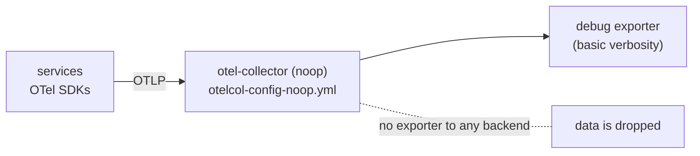

<!-- markdownlint-disable MD013 -->

# Running without telemetry collection: vanilla and no-otel modes

Two Docker Compose overrides run the demo while collecting **no** telemetry. Use
them for app-only demos, for resource-constrained machines, or as a clean test
bed for following a Grafana Cloud / Alloy instrumentation procedure from scratch.

| | `--vanilla` | `--no-otel` |
|---|---|---|
| Command | `./start-local.sh --vanilla` | `./start-local.sh --no-otel` |
| File | `docker-compose.vanilla.yml` | `docker-compose.no-otel.yml` |
| Collector | noop stub | noop stub |
| SDKs | enabled, export to the stub | disabled where the SDK honors `OTEL_SDK_DISABLED` |
| Jaeger, Prometheus, Grafana, OpenSearch | **not started** (profile `local-backends`) | started, show no data |
| flagd metrics export | unchanged | disabled |
| Memory | lowest | similar to the full demo |



## How it works

- **The noop collector.** `src/otel-collector/otelcol-config-noop.yml` has an OTLP
  receiver (gRPC and HTTP, with the CORS settings browser telemetry needs) and only
  the `debug` exporter. The service keeps its name and ports, so every
  `depends_on: otel-collector` in `docker-compose.yml` is satisfied and nothing
  fails to start.
- **Why not delete the collector?** About 15 services depend on it; removing it would
  make Compose refuse to start them.
- **Dependencies.** The overrides remove the collector's dependency on Jaeger and
  OpenSearch (`depends_on: !reset {}`) and, in vanilla mode, frontend-proxy's dependency
  on Jaeger and Grafana, because those services no longer start.
- **`OTEL_SDK_DISABLED=true`** (no-otel only) is set for the SDKs that honor it:
  `accounting`, `ad`, `cart`, `email`, `fraud-detection`, `frontend`, `kafka`,
  `load-generator`, `payment`, `quote`, `recommendation`. Go, C++ and Rust services
  (`checkout`, `currency`, `product-catalog`, `shipping`, ...) ignore it and keep sending
  to the stub, which discards the data.
- **Faro** starts only when `GRAFANA_FARO_ENDPOINT` is set (see
  [faro-and-pyroscope.md](faro-and-pyroscope.md)), so in these modes the browser tracer
  also posts to the stub.

## Verify

```bash
docker compose ps                          # no jaeger/grafana/prometheus/opensearch in vanilla mode
docker compose logs otel-collector | tail  # lines from the debug exporter: data arrives and is dropped
```

## Switch back

```bash
./start-local.sh --stop
./start-local.sh                 # full demo
./start-local.sh --grafana-cloud # lean demo with Grafana Cloud
```

## Send the data to Alloy on your host instead (not tested on this branch)

The original vanilla-mode instructions were: install Alloy on the host with an OTLP
receiver on port 4317 and set, for the Compose run,

```text
OTEL_EXPORTER_OTLP_ENDPOINT=http://host.docker.internal:4317
```

in `.env.override` (it is passed to Compose after the upstream `.env`). The services
read this variable, so they bypass the noop stub; the browser tracer uses a separate
variable (`PUBLIC_OTEL_EXPORTER_OTLP_TRACES_ENDPOINT`) that is not changed by it. This
path has not been run against the 2025 services; if you need Grafana Cloud, prefer
`./start-local.sh --grafana-cloud`, which is the tested route.

## Kubernetes equivalents

`./start-local.sh --k8s-vanilla` (noop collector) and `--k8s-clean` (no collector at
all; SDK export errors in the pod logs are expected and harmless). See
[deployment-guide.md](deployment-guide.md#kubernetes).
