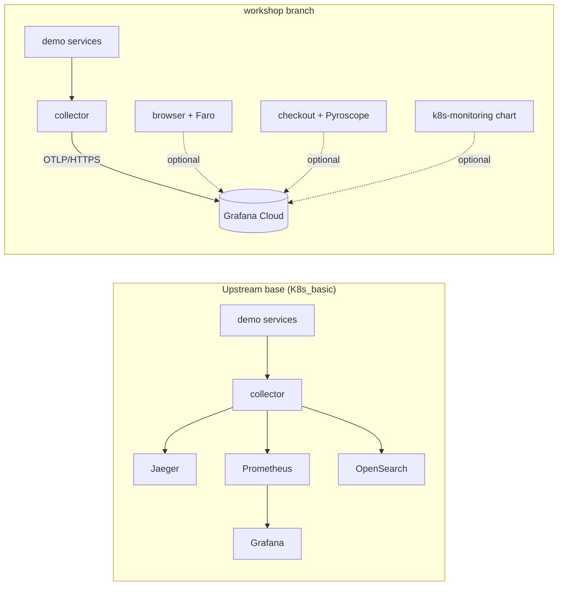
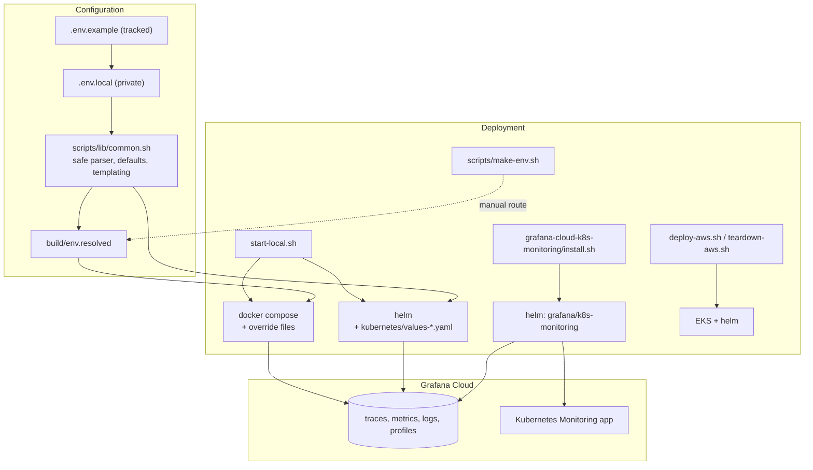

<!-- markdownlint-disable MD013 MD024 MD031 MD033 -->

# Workshop branch: change report

This is the complete record of what was changed on the `workshop` branch, **why**, and **how each
change was verified**. It is written so that someone who was not present can audit the work, repeat
it, or undo any part of it.

| | |
|---|---|
| **Branch** | `workshop` |
| **Base** | `origin/K8s_basic`: the upstream OpenTelemetry Demo, version 2.0.2 (2025-05), plus one commit that adds `grafana-values.yaml` |
| **Contents** | the deployment work of the `minikube` branch (re-implemented for the 2025 code), plus the Grafana fork's Faro and Pyroscope additions |
| **Excluded on purpose** | the `grafana/` exports (about 1,000 files from one Grafana stack), Drone CI, Renovate, `docker-compose.nocache.yml`, `src/frontend/Dockerfile.ci`, the buildkit change, the fork's banner text, `.claude/settings.json` |
| **Pushed** | yes: `origin/workshop` on `rnp68/opentelemetry-demo` (a public fork) |

**Related documents:** [deployment-guide.md](deployment-guide.md) (overview and 1-click scripts) |
[manual-deployment.md](manual-deployment.md) (every step by hand) | [configuration.md](configuration.md) (every variable) |
[workshop-port-plan.md](workshop-port-plan.md) (the original plan and its execution log).

## Contents

1. [Summary](#1-summary)
2. [Before and after](#2-before-and-after)
3. [How the pieces fit together](#3-how-the-pieces-fit-together)
4. [Changes by area](#4-changes-by-area)
5. [Defects found and fixed](#5-defects-found-and-fixed)
6. [Decisions, deviations and what was left out](#6-decisions-deviations-and-what-was-left-out)
7. [Verification](#7-verification)
8. [Inventory (generated from git)](#8-inventory-generated-from-git)
9. [Security and billing notes](#9-security-and-billing-notes)
10. [Version pins](#10-version-pins)
11. [Known limitations and open items](#11-known-limitations-and-open-items)
12. [Process notes (an honest log of slips)](#12-process-notes-an-honest-log-of-slips)
13. [How to repeat the verification](#13-how-to-repeat-the-verification)
14. [How to undo things](#14-how-to-undo-things)

---

## 1. Summary

The upstream demo runs with local Jaeger, Prometheus, Grafana and OpenSearch. This branch adds:

1. **A Grafana-Cloud-only mode** for Docker Compose and for Kubernetes: the collector exports to Grafana Cloud and the four local backends do not run (about 1.8 GB less memory).
2. **Full portability**: every environment-specific value is an environment variable (`.env.example` is the template, `.env.local` holds your values and is never committed).
3. **Optional Faro** (browser monitoring) and **Pyroscope** (profiling of `checkout`) ported from the Grafana fork.
4. **1-click scripts** with preflight, idempotency, undeploy and reset: `start-local.sh` (Compose and local Kubernetes), a Kubernetes-Monitoring installer with a billing gate, AWS deploy and teardown, and an asset renderer.
5. **SLOs, synthetic checks and k6 tests** as templates, with queries corrected against a live stack.
6. **Tests** for the script logic (three test scripts, 60+ checks) and **documentation**: this report, a master deployment guide, a click-by-click manual guide, a configuration reference and one guide per component.

Result of the live runs (details in section 7): the demo ran on Docker Desktop with Docker Compose and on
Docker Desktop's Kubernetes, sending traces, metrics and logs to a real Grafana Cloud stack, and the
cluster appeared in Grafana Cloud's Kubernetes Monitoring page.

## 2. Before and after



| | Upstream base | This branch |
|---|---|---|
| Where telemetry goes | local Jaeger / Prometheus / OpenSearch | Grafana Cloud (or still local, your choice of mode) |
| Configuration | edit tracked files | one private file, `.env.local`, from the template `.env.example` |
| Start | `docker compose up` or Helm by hand | `./start-local.sh <mode>` (or by hand: [manual-deployment.md](manual-deployment.md)) |
| Image versions in Compose | `latest` (drifts) | pinned to 2.0.2 |
| Browser monitoring / profiling | none | Faro / Pyroscope, off until configured |
| Cluster monitoring | none | `grafana/k8s-monitoring` installer |

## 3. How the pieces fit together



## 4. Changes by area

For each area: **what** changed, **why**, and **how it was checked**. File names are relative to the repository root.

### 4.1 Configuration system

- **What:** `.env.example` (38+ variables, all `unknown`), `.gitignore` entries for `.env.local`, `.env.*.local` and `/build/`, and `scripts/lib/common.sh` (a bash-3.2-compatible library).
- **Behavior:** a value that is empty or `unknown` is "not set": the script then uses a built-in default for tunables (chart pins, namespaces, EKS sizing, ...) or stops and prints where to find the value. Precedence: shell environment, then `.env.local`, then the built-in default. A `build/env.resolved` file (mode 0600) is written for Docker Compose with placeholders removed.
- **Why:** the upstream `.env` is tracked and must not hold secrets; the `unknown` placeholder must never reach a container.
- **Safe parser (`parse_env_file`):** `.env.local` is **read**, not executed. A value is its first word; text after it is dropped with a warning; quotes are honored; `$`, `&` and `#` inside a token are safe. Written after `KEY= value` (stray space) silently produced an empty value when the file was executed as shell.
- **Checked by:** `scripts/tests/env-parser-test.sh` (10 checks, includes a mutation that must fail).

### 4.2 Docker Compose overrides and collector configs

- **What:** `docker-compose.grafana-cloud.yml`, `docker-compose.vanilla.yml`, `docker-compose.no-otel.yml`; `src/otel-collector/otelcol-config-grafana-cloud.yml` and `otelcol-config-noop.yml`; two lines in `docker-compose.yml` that pass the Faro and Pyroscope variables through.
- **How they work:** the `local-backends` profile keeps Jaeger, Grafana, Prometheus and OpenSearch from starting; `depends_on: !reset` and `!override` remove the collector's and the proxy's dependencies on them; the collector config exports to the Grafana Cloud OTLP endpoint with basic auth from container environment variables (`GRAFANA_OTLP_ENDPOINT`, `GRAFANA_INSTANCE_ID`, `GRAFANA_CLOUD_APIKEY`).
- **Why:** lean local runs; a collector that needs no local backend.
- **Checked by:** `docker compose config` for every mode; `otelcol-contrib validate` (exit 0, and exit 1 for a deliberately broken copy); live runs (section 7).

### 4.3 Kubernetes (Helm values)

- **What:** `kubernetes/values-local.yaml` (base), `values-vanilla.yaml`, `values-clean.yaml`, `values-grafana-cloud.yaml`, `values-alloy-forward.yaml.tmpl`, `values-alloy-collector.yaml`.
- **Key design points:** credentials are never in a values file (the collector reads a Kubernetes secret `grafana-cloud-otlp`); the chart is pinned to 0.37.8 (demo 2.0.2); the chart does not set `OTEL_K8S_POD_NAME`, so the scripts add it through the downward API; a component key in a values file must never be empty (an empty key deletes the component in Helm).
- **Checked by:** `helm template` for each mode; the rendered collector configs validated with `otelcol-contrib` 0.131.0; a live install (section 7).

### 4.4 `start-local.sh` and the Makefile

- **What:** one script with 11 deployment modes (Compose: full, `--grafana-cloud`, `--vanilla`, `--no-otel`, `--minimal`; Kubernetes: `--k8s`, `--k8s-grafana-cloud`, `--k8s-vanilla`, `--k8s-clean`, `--k8s-alloy-collector`, `--k8s-alloy-forward`), plus `--stop`, `--k8s-stop`, `--status`, `--reset`. Makefile targets `local*` and `local-k8s*` call it.
- **Behavior:** preflight (Docker, kubectl, helm, configuration); detects what is already deployed and upgrades in place; **never changes your current kubectl context** (every call carries `--context`); auto-selects only local contexts (`orbstack`, `docker-desktop`, `minikube`) so a typo cannot deploy to a cloud cluster; builds the `frontend` and `checkout` images locally when Faro or Pyroscope is configured (the upstream images lack that code); tests the Grafana Cloud credentials with one request before starting anything.
- **Checked by:** shellcheck; the generated Helm extras tested in three configurations; live runs.

### 4.5 Faro (browser monitoring)

- **What:** `src/frontend/utils/telemetry/FaroTracer.ts` and `FaroEvents.ts`, `src/frontend/middleware.ts`, and small edits to `_app.tsx`, `_document.tsx`, `next.config.js`, `Api.gateway.ts`, the page files, `Currency.provider.tsx` and `CheckoutForm.tsx`.
- **Behavior:** Faro starts only when `GRAFANA_FARO_ENDPOINT` is set; otherwise the stock OpenTelemetry browser tracer runs (the two never run together because both would instrument the same calls). Failed API calls are reported in one place (the existing API gateway proxy). Page, add-to-cart and currency events are sent through null-safe helpers.
- **Packages:** `@grafana/faro-web-sdk` and `@grafana/faro-web-tracing` **1.13.3**, chosen because they use the OpenTelemetry 1.30.x line this frontend already pins (newer Faro releases pull a second, 2.x OpenTelemetry).
- **Carried over knowingly:** clicking Place Order reports a synthetic Faro error (the fork's demo behavior). **Not ported:** the fork's banner text.
- **Checked by:** `tsc --noEmit` and `next build`. **Not run** against a real Faro collector.

### 4.6 Pyroscope (profiling of `checkout`)

- **What:** `src/checkout/profiling.go`, a few lines in `main.go`, `go.mod`.
- **Behavior:** starts only when `GRAFANA_PYROSCOPE_ADDR` is set; failing to start logs a warning instead of exiting; span profiles link traces to profiles when enabled. Application name is `checkout` (the fork used `checkoutservice`; the service was renamed upstream).
- **Library versions:** `pyroscope-go` 1.2.2 and `otel-profiling-go` 0.5.1: the newest releases force a bump of the core OpenTelemetry Go libraries, which was avoided.
- **Checked by:** `go build`, `gofmt`. **Not run** against Grafana Cloud Profiles.

### 4.7 Selective failure in `product-catalog`

- **What:** `src/product-catalog/main.go` and `pod_name_test.go`.
- **Behavior:** when the pod name matches `product-catalog<N>`, the service also checks the feature flag `fail-product-catalog<N>`, so one deployment can be made to fail on its own.
- **Why the pattern differs from the fork's:** the fork's pattern needed a leading hyphen and could never match the 2025 pod names (`product-catalog-<hash>-<hash>`). The unit test fails with the original pattern.

### 4.8 Cluster monitoring installer (`scripts/grafana-cloud-k8s-monitoring/`)

- **What:** `install.sh` and `values.yaml.tmpl`, documented in [grafana-cloud-k8s-monitoring.md](grafana-cloud-k8s-monitoring.md).
- **Behavior:** (1) **activation gate**: Kubernetes Monitoring must be activated once in the Grafana UI (this starts billing and has no API), so the script stops until you confirm (prompt, `--i-have-activated` or `K8S_MONITORING_ACTIVATED=true`); `--yes` deliberately does **not** answer it. (2) **stack discovery**: with `GCX_CONTEXT` set and a `gcx cloud login`, the six URL/user values are read from the stack. (3) installs chart 4.6.0 with the token in a temporary 0600 file (never on a command line). (4) **data check** that requires samples newer than the install start. (5) `--uninstall` explains how usage stops and how to deactivate (a UI step).
- **Checked by:** `scripts/tests/k8s-monitoring-test.sh` with a fake `gcx`, a live install, and read-back of the data.

### 4.9 AWS scripts

- **What:** `scripts/deploy-aws.sh`, `scripts/teardown-aws.sh` ported from the `minikube` branch; sizing, tags, namespace, release and chart version come from `.env.local`; `--grafana-cloud` skips the local backends; chart pinned with `--version`.
- **Checked by:** shellcheck (the original had one error) and rendering of both YAML heredocs. **Not run on AWS** (needs credentials and creates billable resources).

### 4.10 Grafana-side assets (`grafana-assets/`, `scripts/render-assets.sh`)

- **What:** 4 SLOs, 4 synthetic checks, 4 k6 tests and 4 schedules as templates, rendered with `DEMO_TARGET_URL`, `DEMO_ENVIRONMENT` and `GRAFANA_CLOUD_PROM_DATASOURCE_UID`.
- **Corrections found by testing against the running demo:** the SLO queries used metric names that do not exist on this branch's stack (now span metrics, each checked against live data); the cart request used `cartId` but the API reads `sessionId`; the checkout test never filled the cart; the synthetic checkout check returned HTTP 500 and, once valid, creates a real order per probe (it ships **disabled**).

### 4.11 Tests

Three scripts under `scripts/tests/`, each with at least one control that must fail when the guarded behavior is removed: `env-parser-test.sh`, `credential-check-test.sh`, `k8s-monitoring-test.sh`. Plus `src/product-catalog/pod_name_test.go`.

### 4.12 Documentation

This report; [deployment-guide.md](deployment-guide.md); [manual-deployment.md](manual-deployment.md); [configuration.md](configuration.md); [faro-and-pyroscope.md](faro-and-pyroscope.md); [grafana-cloud-k8s-monitoring.md](grafana-cloud-k8s-monitoring.md); [grafana-assets.md](grafana-assets.md); [aws-deployment.md](aws-deployment.md) (carried over and corrected); [otel-noop-mode.md](otel-noop-mode.md); [workshop-port-plan.md](workshop-port-plan.md); and a README section. All pass the repository's markdown lint and a link/anchor check.

---

## 5. Defects found and fixed

Every item below was found by running or testing something, not by reading. "Commit" is where it was fixed (hashes are in section 8.1).

| # | Symptom or risk | Root cause | Fix | Commit |
|---:|---|---|---|---|
| 1 | Selective failure could never trigger | the fork's pod-name regex needed a leading hyphen; 2025 pods are `product-catalog-<hash>-<hash>` | pattern `(?:^\|-)(product-catalog[0-9]*)-`, unit test (fails with the old pattern) | `927b33e` |
| 2 | Helm would have **deleted** `frontend` and `checkout` | the generated extras file wrote empty `frontend:` / `checkout:` keys, which Helm treats as null | write a component key only when it has content; checked that all 20 deployments survive | `03c8523` |
| 3 | `flagd-ui` crash (`SECRET_KEY_BASE is missing`), `kafka` unhealthy | upstream `.env` sets `DEMO_VERSION=latest`, pulling images newer than the compose file | `DEMO_VERSION` defaults to 2.0.2 through the workshop config | `036eb56` |
| 4 | Synthetic checkout check would fail on every probe | body `{"userId":"health-check"}` returns HTTP 500 | complete order body; shipped disabled because a valid order is a real order | `036eb56` |
| 5 | Java services could crash on Apple M4 | upstream's `.env.arm64` workaround was not passed by the script | passed on Apple Silicon | `4adc54d` |
| 6 | Wrong scopes in the "missing value" hint | one hint covered two tokens with different needs | separate hints | `e855894` |
| 7 | `KEY= value` loaded as an empty value and an error | `.env.local` was executed as shell | safe parser (section 4.1) | `aeb817c` |
| 8 | The preflight blocked a **valid** token | a rule compared the token's embedded region with the endpoint; that field is the stack's home region, not the gateway's cluster (`regionSlug` `prod-us-east-0` vs `clusterSlug` `prod-us-east-2`) | the preflight only sends one request and stops on 401/403; regression test | `1e831b4`, `f5190a6` |
| 9 | The four SLOs would show no data | metric names `http_server_duration_count` and `rpc_server_duration_count` have no series on this stack | span-metrics queries, each tested live | `3d2d4cc` |
| 10 | The cluster-monitoring chart rejected the original values | `^4` now resolves to a chart that refuses `profiling.enabled` without a profile type | chart pinned to 4.6.0; eBPF and Java profiling enabled explicitly | `3d5eb08` |
| 11 | Token visible in the process list | the original installer used `--set-string` for the token | temporary 0600 values file, deleted on exit | `3d5eb08` |
| 12 | `deploy-aws.sh` shebang never honored | a stray en-dash character before `#!` | removed | `73acdf4` |
| 13 | k6 cart and checkout tests were wrong for this API | `cartId` vs `sessionId`; checkout without a cart | corrected from the API handlers; `k6 inspect` passes | `3dcc52d` |
| 14 | Kubernetes Monitoring page stayed empty after a correct install | the app must be **activated** in the UI first; no API exists | activation gate; `--yes` cannot pass it | `787d3c3`, `c88fa01` |
| 15 | `gcx cloud` calls failed with HTTP 401 inside the installer | gcx reads an env variable named `GRAFANA_CLOUD_TOKEN` as its own API token; the installer exports a variable with that name | every `gcx` call runs without it; regression test | `d9131c6` |
| 16 | First real cluster-monitoring install rolled back after 10 minutes | OpenCost reads metrics back and the token had no `metrics:read`; it also needed a **new** token after the scope was added | scope documented and in the hint; troubleshooting table | `6560323` |
| 17 | The installer's "data arrives" check passed on stale data | it matched series left by the rolled-back run | requires a sample newer than the install start; test fails for the old query | `6560323` |
| 18 | Home page still showed "Start sending data" | the page evaluates activation and data flow once at load; an open tab keeps the old answer (read from the app's code, then confirmed: a hard reload fixed it) | documented, with the commands that check each condition | `a22679b` |
| 19 | Stale container from another project blocked the start | fixed container names (`load-generator`) | troubleshooting entry; nothing was deleted without permission | `036eb56` |
| 20 | The manual route would hand `unknown` and trailing text to containers | Compose was pointed at the raw `.env.local` in the first version of the guide | `scripts/make-env.sh`; guide corrected | this report's commit |

## 6. Decisions, deviations and what was left out

| Topic | Decision | Reason |
|---|---|---|
| Merge vs re-implement | re-implemented on the 2025 base | upstream renamed service folders and reworked the frontend; the two histories share only an April 2024 ancestor |
| `grafana/` exports (~1,000 files) | left out | one stack's configuration, mostly OnCall data; may hold sensitive details |
| Drone CI, Renovate, `docker-compose.nocache.yml`, `Dockerfile.ci`, buildkit | left out | Grafana-internal CI that publishes to a private registry; Renovate was removed upstream in Feb 2025 |
| Fork's banner text | not ported | cosmetic and not part of Faro |
| Fork's fake Faro error on Place Order | kept, documented | it is the fork's Faro demo behavior; remove the `onClick` to turn it off |
| Faro replaces the OpenTelemetry browser tracer | only when configured | the fork replaced it always |
| Hardcoded Grafana stack IDs and URLs | all removed | portability |
| `--yes` and billing | `--yes` never acknowledges the activation | a blanket "yes" must not accept a billing decision |
| Kubernetes Monitoring activation | not automated | Grafana documents no API |
| Compose image tag | pinned to 2.0.2 | upstream `.env` says `latest` |

## 7. Verification

### 7.1 Run live (2026-11-08 and 2026-11-09, Mac Studio M3 Ultra, Docker Desktop)

| Run | Result |
|---|---|
| `./start-local.sh --vanilla` (Docker Compose) | 21 containers up and stable; shop, load generator and feature-flag pages answer 200; products, cart, add-to-cart and order APIs answer 200; the noop collector receives data; no backend started. Two defects found and fixed (items 3 and 19) |
| `./start-local.sh --grafana-cloud` (Docker Compose) | the first attempt failed with HTTP 401 on every export (token problem, items 8 and later); after a working token: 21 containers, **0 export failures**, traces, metrics (17 services) and logs read back from the stack with `gcx`, timestamps after the collector's start |
| `./start-local.sh --k8s-grafana-cloud` (Docker Desktop Kubernetes) | 20/20 deployments available, 0 restarts, no local backends; traces (7 services), metrics (17 pods) and logs read back, filtered to `k8s.namespace.name=otel-demo` |
| `scripts/grafana-cloud-k8s-monitoring/install.sh` | first attempt rolled back (item 16); after a correct token: release `deployed`, 12 pods Ready, cluster, node, container, cost and energy metrics read back from the stack; the home page showed the cluster after a hard reload (confirmed by the user) |

### 7.2 Static and isolated checks

shellcheck (error level) on every script; the three test scripts (60+ checks, each with a control or mutation that must fail); `docker compose config` for every mode; `helm template` for every values combination against chart 0.37.8 and for chart 4.6.0 (62 objects); collector configs validated with `otelcol-contrib`; `tsc --noEmit` and `next build` (frontend); `go build` (checkout, product-catalog) and the product-catalog unit test; `k6 inspect` for all four load tests; markdown lint with the repository configuration; a link and anchor check over all docs; a pattern scan for secrets over every commit. The commands in [manual-deployment.md](manual-deployment.md) (Parts E, F, G) were run as dry runs.

### 7.3 Not run

- AWS deployment and teardown (needs AWS credentials; creates billable resources).
- minikube and OrbStack as the cluster; the Kubernetes modes `--k8s`, `--k8s-vanilla`, `--k8s-clean`, `--k8s-alloy-collector`, `--k8s-alloy-forward` (the chart renders; not installed).
- Faro and Pyroscope against Grafana Cloud (built and type-checked only).
- The installer's `--uninstall` path and the Kubernetes Monitoring deactivation (a UI step).
- The synthetic checks and k6 tests against Grafana Cloud (rendered and syntax-checked only).
- The manual guide's portal click paths for Faro (not confirmed; marked in the text).

---

## 8. Inventory (generated from git)

### 8.1 Commits

Generated from `git log origin/K8s_basic..HEAD` at `a22679b` (the commit that adds this report, and the manual guide, is the last one on the branch).

| # | Commit | Date | Subject |
|---:|---|---|---|
| 1 | `3152f6e` | 2026-11-08 21:24 | docs: add workshop branch port plan |
| 2 | `f17b388` | 2026-11-08 21:25 | feat(product-catalog): fail selectively per deployment via feature flag |
| 3 | `a5c6534` | 2026-11-08 21:25 | feat(checkout): add opt-in Pyroscope continuous profiling |
| 4 | `29f0cb4` | 2026-11-08 21:27 | feat(frontend): add opt-in Grafana Faro browser monitoring |
| 5 | `5b44393` | 2026-11-08 21:29 | feat(config): add env-var configuration foundation |
| 6 | `1f05372` | 2026-11-08 21:32 | feat(compose): add Grafana Cloud, vanilla and no-otel overrides |
| 7 | `927b33e` | 2026-11-08 21:34 | fix(product-catalog): match pod names without a release prefix |
| 8 | `4711b2e` | 2026-11-08 21:34 | feat(kubernetes): add parameterized Helm values for each deployment mode |
| 9 | `03c8523` | 2026-11-08 21:37 | feat: add 1-click start-local.sh for Compose and local Kubernetes |
| 10 | `aab33bb` | 2026-11-08 21:37 | feat(make): add local deployment targets |
| 11 | `3d5eb08` | 2026-11-08 21:39 | feat(k8s-monitoring): port the Grafana Cloud k8s-monitoring installer |
| 12 | `73acdf4` | 2026-11-08 21:41 | feat(aws): port EKS deploy and teardown scripts |
| 13 | `3dcc52d` | 2026-11-08 21:43 | feat(grafana-assets): port SLOs, synthetic checks and k6 tests as templates |
| 14 | `bee49bc` | 2026-11-08 21:48 | docs: add deployment guide and per-component documentation |
| 15 | `036eb56` | 2026-11-08 22:06 | fix: pin Compose images to 2.0.2; correct the synthetic checkout check |
| 16 | `4adc54d` | 2026-11-08 22:15 | fix(scripts): pass .env.arm64 to Compose on Apple Silicon; document the .env files |
| 17 | `e855894` | 2026-11-08 23:07 | fix(scripts): list the correct token scopes for GRAFANA_CLOUD_APIKEY |
| 18 | `aeb817c` | 2026-11-08 23:08 | fix(config): parse .env.local instead of sourcing it |
| 19 | `1e831b4` | 2026-11-08 23:14 | feat(start-local): test Grafana Cloud credentials before deploying |
| 20 | `f5190a6` | 2026-11-08 23:44 | fix(start-local): decide on the real request, not the token's region field |
| 21 | `3d2d4cc` | 2026-11-08 23:49 | fix(grafana-assets): SLOs use span metrics that exist on this branch |
| 22 | `a3afe68` | 2026-11-09 00:06 | docs: record the live Kubernetes (docker-desktop) Grafana Cloud run |
| 23 | `787d3c3` | 2026-11-09 00:24 | docs: Kubernetes Monitoring must be activated in the UI first |
| 24 | `c88fa01` | 2026-11-09 00:29 | feat(k8s-monitoring): activation gate, data check and decommission guidance |
| 25 | `d9131c6` | 2026-11-09 00:37 | feat(k8s-monitoring): discover the stack's connection values with gcx |
| 26 | `6560323` | 2026-11-09 00:57 | fix(k8s-monitoring): require metrics:read, and a data check that cannot pass on stale data |
| 27 | `a22679b` | 2026-11-09 01:04 | docs(k8s-monitoring): why the home page can still show 'Start sending data' |

### 8.2 Files

`A` = added, `M` = modified, relative to the upstream base `origin/K8s_basic`. Lock files are omitted.

**Configuration and shared tooling** (8 files)

| | File | What it is |
|---|---|---|
| A | `.env.example` | Template of every workshop variable; all values `unknown` (tracked). Copy to `.env.local`. |
| M | `.gitignore` | Ignores `.env.local`, `.env.*.local` and `/build/`. |
| M | `Makefile` | Adds `local*` and `local-k8s*` targets that call `start-local.sh`. |
| A | `scripts/lib/common.sh` | Shared library: config loading, safe parser, defaults, templating, credential preflight. |
| A | `scripts/make-env.sh` | Writes `build/env.resolved` without deploying (for the manual route). |
| A | `scripts/tests/credential-check-test.sh` | Tests for the OTLP credential preflight (11 checks). |
| A | `scripts/tests/env-parser-test.sh` | Tests for the `.env.local` parser (10 checks). |
| A | `scripts/tests/k8s-monitoring-test.sh` | Tests for the activation gate, discovery, data check, decommission note (30+ checks). |

**Docker Compose and collector** (6 files)

| | File | What it is |
|---|---|---|
| A | `docker-compose.grafana-cloud.yml` | Compose override: no local backends, collector exports to Grafana Cloud only. |
| A | `docker-compose.no-otel.yml` | Compose override: noop collector, SDKs disabled, backends still run. |
| A | `docker-compose.vanilla.yml` | Compose override: no backends, noop collector. |
| M | `docker-compose.yml` | Passes `GRAFANA_FARO_ENDPOINT` to `frontend` and `GRAFANA_PYROSCOPE_*` to `checkout`. |
| A | `src/otel-collector/otelcol-config-grafana-cloud.yml` | Collector config exporting to Grafana Cloud only (validated with otelcol-contrib). |
| A | `src/otel-collector/otelcol-config-noop.yml` | Collector config that accepts and drops telemetry. |

**Kubernetes (Helm values)** (6 files)

| | File | What it is |
|---|---|---|
| A | `kubernetes/values-alloy-collector.yaml` | Values for the `grafana/alloy` chart used as the demo's collector. |
| A | `kubernetes/values-alloy-forward.yaml.tmpl` | Helm template: collector forwards to the k8s-monitoring Alloy receiver. |
| A | `kubernetes/values-clean.yaml` | Helm: no backends, no collector. |
| A | `kubernetes/values-grafana-cloud.yaml` | Helm: chart collector exports to Grafana Cloud; credentials from a Kubernetes secret. |
| A | `kubernetes/values-local.yaml` | Base Helm values (frontend-proxy as ClusterIP). |
| A | `kubernetes/values-vanilla.yaml` | Helm: no backends, noop collector. |

**1-click scripts** (6 files)

| | File | What it is |
|---|---|---|
| A | `scripts/deploy-aws.sh` | EKS deployment (ported; env-driven; `--grafana-cloud`). |
| A | `scripts/grafana-cloud-k8s-monitoring/install.sh` | Installs `grafana/k8s-monitoring`: activation gate, stack discovery, data check, decommission guidance. |
| A | `scripts/grafana-cloud-k8s-monitoring/values.yaml.tmpl` | Chart values template (no account-specific value inside). |
| A | `scripts/render-assets.sh` | Renders SLO / synthetic check / k6 templates with your values. |
| A | `scripts/teardown-aws.sh` | Verified removal of every AWS resource created by the deploy. |
| A | `start-local.sh` | 1-click deployment for Docker Compose and local Kubernetes (11 modes, status, reset). |

**Faro (frontend)** (14 files)

| | File | What it is |
|---|---|---|
| M | `src/frontend/components/CheckoutForm/CheckoutForm.tsx` | Faro demo error on Place Order (carried over from the fork). |
| M | `src/frontend/gateways/Api.gateway.ts` | Reports failed API calls to Faro in one central place. |
| A | `src/frontend/middleware.ts` | `server-timing: traceparent` header linking page loads to server traces. |
| M | `src/frontend/next.config.js` | Passes the Faro endpoint to the browser; enables production source maps. |
| M | `src/frontend/package.json` | Adds `@grafana/faro-web-sdk` and `@grafana/faro-web-tracing` 1.13.3. |
| M | `src/frontend/pages/_app.tsx` | Chooses Faro or the stock OpenTelemetry browser tracer. |
| M | `src/frontend/pages/_document.tsx` | Hands `GRAFANA_FARO_ENDPOINT` to the browser at request time. |
| M | `src/frontend/pages/cart/checkout/[orderId]/index.tsx` | Faro page event. |
| M | `src/frontend/pages/cart/index.tsx` | Faro page event. |
| M | `src/frontend/pages/index.tsx` | Faro page event. |
| M | `src/frontend/pages/product/[productId]/index.tsx` | Faro page event. |
| M | `src/frontend/providers/Currency.provider.tsx` | Faro currency-selection event and log. |
| A | `src/frontend/utils/telemetry/FaroEvents.ts` | Null-safe helpers for Faro events, logs and errors. |
| A | `src/frontend/utils/telemetry/FaroTracer.ts` | Starts Faro when `GRAFANA_FARO_ENDPOINT` is set. |

**Pyroscope and selective failure (Go services)** (5 files)

| | File | What it is |
|---|---|---|
| M | `src/checkout/go.mod` | Adds `pyroscope-go` 1.2.2 and `otel-profiling-go` 0.5.1. |
| M | `src/checkout/main.go` | Wires profiling into startup and tracer setup. |
| A | `src/checkout/profiling.go` | Opt-in Pyroscope profiling for `checkout`. |
| M | `src/product-catalog/main.go` | Selective failure by pod name (`fail-product-catalog<N>` flag). |
| A | `src/product-catalog/pod_name_test.go` | Unit test for the pod-name pattern. |

**Grafana-side assets** (16 files)

| | File | What it is |
|---|---|---|
| A | `grafana-assets/k6/cart.js` | k6 load test (target from `DEMO_TARGET_URL`). |
| A | `grafana-assets/k6/checkout.js` | k6 load test (target from `DEMO_TARGET_URL`). |
| A | `grafana-assets/k6/homepage.js` | k6 load test (target from `DEMO_TARGET_URL`). |
| A | `grafana-assets/k6/products.js` | k6 load test (target from `DEMO_TARGET_URL`). |
| A | `grafana-assets/k6/schedules/cart.yaml` | k6 schedule (placeholder test ID). |
| A | `grafana-assets/k6/schedules/checkout.yaml` | k6 schedule (placeholder test ID). |
| A | `grafana-assets/k6/schedules/homepage.yaml` | k6 schedule (placeholder test ID). |
| A | `grafana-assets/k6/schedules/products.yaml` | k6 schedule (placeholder test ID). |
| A | `grafana-assets/slo/add-to-cart.yaml` | SLO template (span-metrics query, verified on a live stack). |
| A | `grafana-assets/slo/browse-products.yaml` | SLO template (span-metrics query, verified on a live stack). |
| A | `grafana-assets/slo/checkout.yaml` | SLO template (span-metrics query, verified on a live stack). |
| A | `grafana-assets/slo/recommendation.yaml` | SLO template (span-metrics query, verified on a live stack). |
| A | `grafana-assets/synthetic-checks/cart.yaml` | Synthetic Monitoring check template. |
| A | `grafana-assets/synthetic-checks/checkout.yaml` | Synthetic Monitoring check template. Ships **disabled**. |
| A | `grafana-assets/synthetic-checks/homepage.yaml` | Synthetic Monitoring check template. |
| A | `grafana-assets/synthetic-checks/products.yaml` | Synthetic Monitoring check template. |

**Documentation** (12 files)

| | File | What it is |
|---|---|---|
| M | `README.md` | Adds the "Workshop branch extensions" section and links. |
| A | `docs/README.md` | Documentation. |
| A | `docs/aws-deployment.md` | Documentation. |
| A | `docs/configuration.md` | Documentation. |
| A | `docs/deployment-guide.md` | Documentation. |
| A | `docs/faro-and-pyroscope.md` | Documentation. |
| A | `docs/grafana-assets.md` | Documentation. |
| A | `docs/grafana-cloud-k8s-monitoring.md` | Documentation. |
| A | `docs/manual-deployment.md` | Documentation. |
| A | `docs/otel-noop-mode.md` | Documentation. |
| A | `docs/workshop-changes.md` | Documentation. |
| A | `docs/workshop-port-plan.md` | Documentation. |

Totals: 75 files changed, 8535 insertions(+), 6 deletions(-) (including lock files and documentation).

---

## 9. Security and billing notes

- **Secrets never enter tracked files.** `.env.local`, `build/` and `.env.*.local` are git-ignored; scripts create `.env.local` and `build/env.resolved` with mode 0600; before each commit the staged diff was scanned for token and key patterns (a pattern scan is a safeguard, not a guarantee).
- **Tokens never appear on a command line.** Test requests pass credentials to `curl` through standard input (`curl -K -`); the cluster-monitoring token goes into a temporary 0600 file that is deleted on exit; the demo's credentials go into Kubernetes secrets.
- **One property to know:** Helm stores the values it was given, including the cluster-monitoring token, in a release record (a Kubernetes secret) in the cluster. Treat access to the namespace as access to the token, and delete the release when you are done.
- **A token in a process environment** is how `start-local.sh` and the installer carry it; it is not exported to child programs that do not need it (`gcx` calls explicitly drop `GRAFANA_CLOUD_TOKEN`).
- **Billing.** Kubernetes Monitoring activation starts billing by active host hours and container hours, metered from `kube-state-metrics`; the scripts never activate it and never deactivate it. Check your plan first. AWS deployment creates paid resources; always finish with `scripts/teardown-aws.sh`.
- **Destructive actions** (removing containers, namespaces, Helm releases) happen only in the documented `--stop`, `--k8s-stop`, `--reset` and `--uninstall` paths; one stale container from another project was removed during testing, at the owner's explicit request.

## 10. Version pins

| Component | Version | Where set |
|---|---|---|
| Demo images (Compose) | 2.0.2 | `DEMO_VERSION` default, `scripts/lib/common.sh` |
| `open-telemetry/opentelemetry-demo` chart | 0.37.8 (demo 2.0.2) | `OTEL_DEMO_CHART_VERSION` |
| `grafana/k8s-monitoring` chart | 4.6.0 | `K8S_MONITORING_CHART_VERSION` |
| `grafana/alloy` chart (alloy-collector mode) | 1.8.1 | `ALLOY_CHART_VERSION` |
| Collector image (Compose) | contrib 0.125.0 | upstream `.env` |
| Collector image (chart) | contrib 0.131.0 | the chart |
| `@grafana/faro-web-sdk`, `@grafana/faro-web-tracing` | 1.13.3 | `src/frontend/package.json` |
| `pyroscope-go`, `otel-profiling-go` | 1.2.2, 0.5.1 | `src/checkout/go.mod` |
| EKS Kubernetes | 1.33 | `EKS_K8S_VERSION` |

## 11. Known limitations and open items

1. Faro and Pyroscope need locally built `frontend` and `checkout` images; clusters that cannot see local images (for example EKS) keep the upstream images unless you push yours to a registry and set `imageOverride`.
2. The eBPF profiler cannot start on Docker Desktop's Linux kernel (`alloy-profiles` logs a load error); my reading is that this is an environment limit, not confirmed with the vendor.
3. The synthetic **checkout** check is disabled by default because each probe creates an order.
4. The SLO queries use span metrics, not SDK metrics, so they depend on the collector's `spanmetrics` connector being in the pipeline (it is in this branch's collector configs).
5. `go vet` reports pre-existing findings in upstream `product-catalog` and `checkout` code (Go 1.27), so `go test` there needs `-vet=off`.
6. An unexplained `shellcheck` exit status of 1 (with no output) was seen three times when run through Docker; it never reproduced in repeated runs.
7. Billing and pricing details for your Grafana plan are yours to check.
8. The branch has not been pushed.

## 12. Process notes (an honest log of slips)

These did not reach users but are recorded so the audit trail is complete.

1. A temporary handoff note (`docs/handoff-grafana-cloud-lean-deploy.md`) was staged by a broad `git add` twice and amended out of unpushed commits before any push. It is intentionally **not** part of the branch.
2. One commit was made while its newest test check was failing (a bug in the test: it captured the wrong output stream); the commit was amended and the test now passes with a control.
3. A verification command stored a command in a shell variable that did not expand, producing false zero counts; those numbers were discarded and the checks re-run with literal commands.
4. A wrong diagnosis (token region) was acted on, then corrected with evidence (item 8).
5. A "data arrives" check that could pass on stale data was found only because a run was rolled back and re-run (item 17).

## 13. How to repeat the verification

```bash
# tests of the script logic (no network, no cluster needed)
scripts/tests/env-parser-test.sh
scripts/tests/credential-check-test.sh
scripts/tests/k8s-monitoring-test.sh
(cd src/product-catalog && go test -vet=off -run TestPodNamePattern .)

# static validation
scripts/make-env.sh                       # writes build/env.resolved
for o in grafana-cloud vanilla no-otel; do
  docker compose --env-file .env --env-file build/env.resolved -f docker-compose.yml -f docker-compose.$o.yml config -q && echo "compose $o ok"
done
for f in vanilla clean grafana-cloud; do
  helm template d open-telemetry/opentelemetry-demo --version 0.37.8 -f kubernetes/values-local.yaml -f kubernetes/values-$f.yaml >/dev/null && echo "helm $f ok"
done
docker run --rm -v "$PWD:/mnt" -w /mnt koalaman/shellcheck:stable -x -P SCRIPTDIR -S error start-local.sh scripts/*.sh scripts/lib/common.sh scripts/grafana-cloud-k8s-monitoring/install.sh

# live (needs Docker and your Grafana values)
./start-local.sh --grafana-cloud          # then follow manual-deployment.md E.7 to see the data
```

## 14. How to undo things

| To undo | Do |
|---|---|
| A running deployment | `./start-local.sh --stop` / `--k8s-stop` / `--reset`; manual: [manual-deployment.md, Part J](manual-deployment.md#part-j-remove-everything) |
| Cluster monitoring | `scripts/grafana-cloud-k8s-monitoring/install.sh --uninstall`, then Deactivate in the UI if you want billing off |
| This whole branch locally | `git checkout <another branch>`; `git branch -D workshop` (only if you are sure; nothing is pushed) |
| One change | `git revert <commit>` using the hashes in section 8.1; commits are small and each message states what it changed |
| Generated files | `rm -rf build` (keeps `.env.local`) |
| The token | delete it on its access policy in Grafana Cloud |
