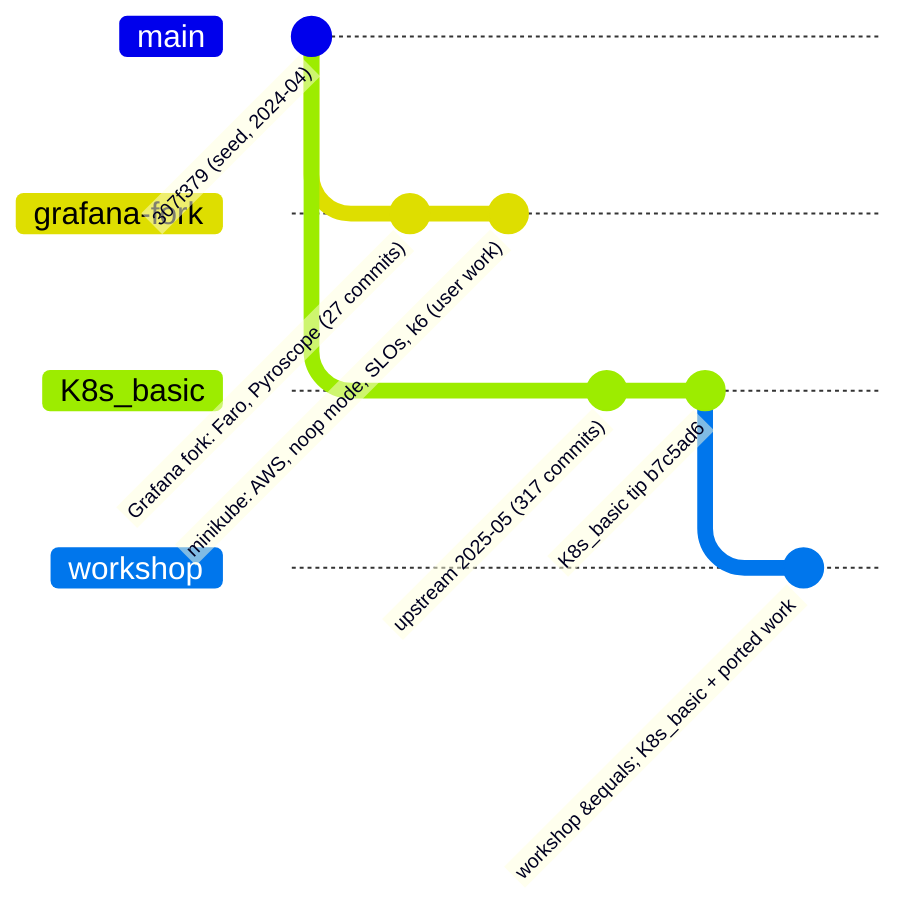
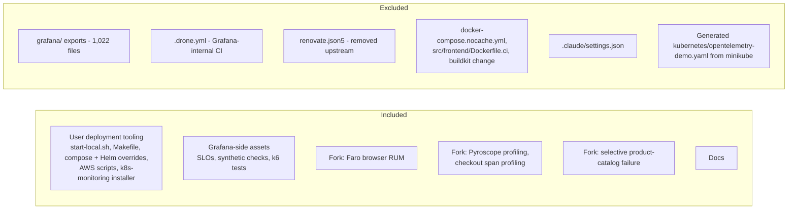

# Workshop Branch Port Plan

Status: **in execution** · Branch: `workshop` · Base: `origin/K8s_basic` (upstream OpenTelemetry Demo 2.0.2, May 2025)

This document is the plan for building the `workshop` branch: the 2025 upstream
demo plus (1) the deployment work from the `minikube` branch and (2) the Grafana
fork additions (Faro and Pyroscope). It is updated as work proceeds; the
"Execution log" at the end records what was actually done.

## 1. Why this branch exists

Two lineages share one old ancestor (`307f379`, 2024-04-17):

`minikube` is the older lineage with the extras; `K8s_basic` is the newer
upstream. `workshop` starts from the newer one and brings the extras across.

## 2. Principles

| Principle | Consequence |
|---|---|
| Re-implement, do not merge | Upstream renamed service folders (`checkoutservice` to `checkout`, `otelcollector` to `otel-collector`, ...). A merge would fight those renames. |
| 100% portable | Every environment-specific value (stack IDs, endpoints, cluster names, chart version, AWS settings) comes from an environment variable. |
| Secrets never in tracked files | `.env.example` is tracked with `unknown` placeholders; `.env.local` holds real values and is gitignored. The upstream tracked `.env` is not modified. |
| Validate before commit | `docker compose config`, `helm template`/`lint`, `shellcheck`, and a secret scan on staged files. |
| Documentation matches the code | Every script and file is documented in `docs/`. |

## 3. Scope

## 4. Compatibility audit (summary)

| Item | Result on `K8s_basic` | Action |
|---|---|---|
| Compose service names | Differ (`otelcol` to `otel-collector`, `frontendproxy` to `frontend-proxy`, `redis-cart` to `valkey-cart`, `loadgenerator` to `load-generator`, ...) | Rebuild overrides |
| `docker-compose.vanilla.yml`, `no-otel.yml` | Do not exist | Recreate against new names |
| Helm values (`values-*.yaml`) | Render with chart 0.37.8 | Port; parameterize |
| Collector service name | `otel-collector` in namespace `otel-demo` | Install Alloy as `otel-collector` in `otel-demo` |
| `start-local.sh`, `Makefile` | Reference removed files and old names | Rewrite / re-apply hunks |
| AWS scripts | Depend only on the Helm chart | Port; pin chart version |
| `grafana-cloud-k8s-monitoring` | Independent of repo files | Port; parameterize stack IDs |
| SLO / k6 / check files | Metric names unverified | Verify against live data |

## 5. Phases

### Phase 0 - Preparation
- Pin Helm chart: `0.37.8` (demo 2.0.2).
- Baseline: `docker compose config` and `helm template` on the untouched base.
- Trial-apply each fork change in a scratch worktree and classify
  clean / conflict / obsolete.

### Phase 1 - Configuration foundation
- `.env.example` (tracked, every value `unknown`) and `.env.local` (gitignored).
- Preflight helper that checks every key in `.env.example` has a value.

### Phase 2 - Fork additions
- Faro browser RUM in `src/frontend`.
- Pyroscope profiling; span profiling for `checkout`.
- Selective failure in `product-catalog`.

### Phase 3 - Deployment tooling
- Compose overrides (noop and Grafana-Cloud-only collector).
- Helm values files.
- `start-local.sh` and `Makefile` targets.
- AWS deploy/teardown scripts.
- Grafana Cloud k8s-monitoring installer.

### Phase 4 - Grafana-side assets
- SLOs, synthetic checks, k6 tests, with all stack-specific values parameterized.

### Phase 5 - Documentation
- Per-component procedures, a master deployment guide, diagrams.

### Phase 6 - Verification
- Static: compose/helm/shellcheck/secret scan on every commit.
- Runtime: compose on OrbStack, Helm on minikube, telemetry visible in
  Grafana Cloud, Faro and Pyroscope data present, SLO queries return data.

## 6. Decisions

| Decision | Value |
|---|---|
| Helm chart | `0.37.8` |
| Faro and Pyroscope | Included, endpoints via env vars |
| `grafana/` exports | Excluded |
| Drone CI, Renovate, nocache compose, `Dockerfile.ci`, buildkit change | Dropped (internal CI / removed upstream) |
| Secrets handling | `.env.example` tracked, `.env.local` gitignored |

## 7. Execution log

_Filled in as work proceeds._
