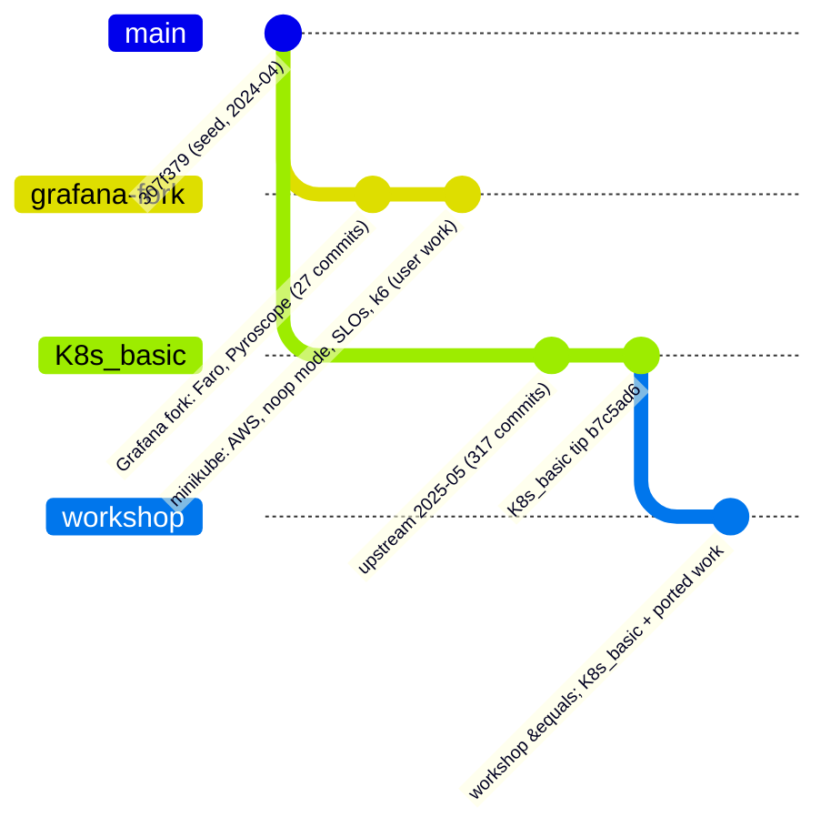
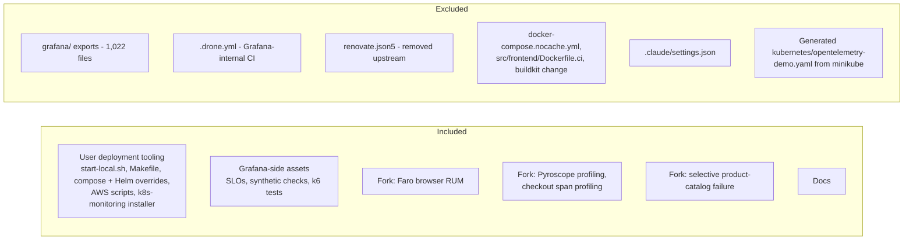

<!-- markdownlint-disable MD013 -->

# Workshop Branch Port Plan

Status: **implemented; runtime verification pending** (see section 8) · Branch: `workshop` · Base: `origin/K8s_basic` (upstream OpenTelemetry Demo 2.0.2, May 2025)

This document is the plan for building the `workshop` branch: the 2025 upstream
demo plus (1) the deployment work from the `minikube` branch and (2) the Grafana
fork additions (Faro and Pyroscope). It is updated as work proceeds; the
"Execution log" at the end records what was actually done.

## 1. Why this branch exists

Two lineages share one old ancestor (`307f379`, 2024-04-17):

`minikube` is the older lineage with the extras; `K8s_basic` is the newer
upstream. `workshop` starts from the newer one and brings the extras across.

## 2. Principles

| Principle | Consequence |
|---|---|
| Re-implement, do not merge | Upstream renamed service folders (`checkoutservice` to `checkout`, `otelcollector` to `otel-collector`, ...). A merge would fight those renames. |
| 100% portable | Every environment-specific value (stack IDs, endpoints, cluster names, chart version, AWS settings) comes from an environment variable. |
| Secrets never in tracked files | `.env.example` is tracked with `unknown` placeholders; `.env.local` holds real values and is gitignored. The upstream tracked `.env` is not modified. |
| Validate before commit | `docker compose config`, `helm template`/`lint`, `shellcheck`, and a secret scan on staged files. |
| Documentation matches the code | Every script and file is documented in `docs/`. |

## 3. Scope

## 4. Compatibility audit (summary)

| Item | Result on `K8s_basic` | Action |
|---|---|---|
| Compose service names | Differ (`otelcol` to `otel-collector`, `frontendproxy` to `frontend-proxy`, `redis-cart` to `valkey-cart`, `loadgenerator` to `load-generator`, ...) | Rebuild overrides |
| `docker-compose.vanilla.yml`, `no-otel.yml` | Do not exist | Recreate against new names |
| Helm values (`values-*.yaml`) | Render with chart 0.37.8 | Port; parameterize |
| Collector service name | `otel-collector` in namespace `otel-demo` | Install Alloy as `otel-collector` in `otel-demo` |
| `start-local.sh`, `Makefile` | Reference removed files and old names | Rewrite / re-apply hunks |
| AWS scripts | Depend only on the Helm chart | Port; pin chart version |
| `grafana-cloud-k8s-monitoring` | Independent of repo files | Port; parameterize stack IDs |
| SLO / k6 / check files | Metric names unverified | Verify against live data |

## 5. Phases

### Phase 0 - Preparation

- Pin Helm chart: `0.37.8` (demo 2.0.2).
- Baseline: `docker compose config` and `helm template` on the untouched base.
- Trial-apply each fork change in a scratch worktree and classify
  clean / conflict / obsolete.

### Phase 1 - Configuration foundation

- `.env.example` (tracked, every value `unknown`) and `.env.local` (gitignored).
- Preflight helper that checks every key in `.env.example` has a value.

### Phase 2 - Fork additions

- Faro browser RUM in `src/frontend`.
- Pyroscope profiling; span profiling for `checkout`.
- Selective failure in `product-catalog`.

### Phase 3 - Deployment tooling

- Compose overrides (noop and Grafana-Cloud-only collector).
- Helm values files.
- `start-local.sh` and `Makefile` targets.
- AWS deploy/teardown scripts.
- Grafana Cloud k8s-monitoring installer.

### Phase 4 - Grafana-side assets

- SLOs, synthetic checks, k6 tests, with all stack-specific values parameterized.

### Phase 5 - Documentation

- Per-component procedures, a master deployment guide, diagrams.

### Phase 6 - Verification

- Static: compose/helm/shellcheck/secret scan on every commit.
- Runtime: compose on OrbStack, Helm on minikube, telemetry visible in
  Grafana Cloud, Faro and Pyroscope data present, SLO queries return data.

## 6. Decisions

| Decision | Value |
|---|---|
| Helm chart | `0.37.8` |
| Faro and Pyroscope | Included, endpoints via env vars |
| `grafana/` exports | Excluded |
| Drone CI, Renovate, nocache compose, `Dockerfile.ci`, buildkit change | Dropped (internal CI / removed upstream) |
| Secrets handling | `.env.example` tracked, `.env.local` gitignored |

## 7. Execution log

Commits on `workshop`, in order (`git log --oneline origin/K8s_basic..workshop`):

| Phase | What was done | How it was checked |
|---|---|---|
| 0 | Plan document | - |
| 2 | `product-catalog`: selective failure by pod name; **fixed** the fork's regex, which could not match 2025 pod names (it needed a leading hyphen) | Go unit test; the test fails with the original pattern |
| 2 | `checkout`: opt-in Pyroscope profiling in `profiling.go` (starts only when configured; failure to start is a warning, not an exit) | `go build`, `gofmt`; module versions chosen to avoid bumping the pinned OpenTelemetry Go libraries |
| 2 | `frontend`: opt-in Faro (Faro 1.13.3, matching the pinned OpenTelemetry 1.30.x), null-safe helpers, one central API-error hook | `tsc --noEmit`, `next build` |
| 1 | `.env.example`, `.gitignore`, `scripts/lib/common.sh` | exercised: defaults, precedence, `unknown` handling, template renderer, missing-value path |
| 3 | Compose overrides (`grafana-cloud`, `vanilla`, `no-otel`) and collector configs | `docker compose config` for all three; `otelcol-contrib validate` exit 0, and exit 1 for a broken copy |
| 3 | Helm values for 6 modes | each renders with chart 0.37.8; rendered collector configs pass `otelcol-contrib 0.131.0 validate`; Alloy chart renders |
| 3 | `start-local.sh` and Makefile targets | shellcheck clean; the generated Helm extras tested in three configurations (this found and fixed a bug that would have deleted the frontend and checkout components) |
| 3 | `grafana-cloud-k8s-monitoring/install.sh` | shellcheck clean; template renders and the chart renders for 5 chart versions; **chart pinned to 4.6.0** because the original `^4` now fails validation |
| 3 | `deploy-aws.sh`, `teardown-aws.sh` | shellcheck (the original had an error: a stray character before the shebang), YAML heredocs rendered; **not run against AWS** |
| 4 | Grafana assets as templates, `render-assets.sh` | k6 scripts pass `k6 inspect` (negative control exits 107); rendered YAML parses; cart/checkout request shapes corrected from the handler code |
| 5 | Documentation | link and anchor check |

## 8. Verification status

**Run live (2026-11-09), Docker Desktop, `./start-local.sh --vanilla`:** all 21
containers start on the 2.0.2 images and stay up; the shop, load generator and feature
flag pages answer 200; `GET /api/products`, `GET /api/cart?sessionId=...`, adding an item
to the cart and placing an order all answer 200; the noop collector receives telemetry;
none of Jaeger, Grafana, Prometheus or OpenSearch starts. The first attempts found two
real defects, both fixed:

- a stale container from another project held the fixed name `load-generator` (documented
  in the troubleshooting table);
- the upstream `.env` sets `DEMO_VERSION=latest`, so Compose pulled today's images, which do
  not match this compose file (`flagd-ui` crashed with `SECRET_KEY_BASE is missing`, `kafka`
  failed its health check). The workshop now defaults `DEMO_VERSION` to 2.0.2.

The same test showed the original synthetic checkout check returns 500; it was corrected
and ships disabled.

**Grafana Cloud run (2026-11-09), first attempt: failed with HTTP 401.** The collector's
exports to `otlp-gateway-prod-us-east-2.grafana.net` failed for traces, metrics and logs, and
a direct request with the same credentials also gave 401, so the collector config was not at
fault. The first two tokens had been created at the organization level; a token created from
inside the stack (stack menu > Administration > Cloud access policies) was accepted
(traces 200, metrics 200, logs 204; a wrong password still gives 401).

A note on a wrong diagnosis, now explained: I first attributed the 401 to the token's embedded
region (`prod-us-east-0`) not matching the endpoint (`prod-us-east-2`), and added a preflight that
stopped on that mismatch. The working token carries the same field, so the rule would have blocked
a valid token and it was removed: the preflight now only sends one request and stops on 401/403
(`scripts/tests/credential-check-test.sh`, which includes a regression test for this). After a
`gcx cloud login`, `gcx cloud stacks get demosrnp68` shows why: the stack's `regionSlug` is
`prod-us-east-0` (that is what the token field holds) while its `clusterSlug`, which names the OTLP
gateway, is `prod-us-east-2`. What exactly made the first tokens fail is still not established;
the stack-level creation path is what is documented to work.

**Grafana Cloud run, second attempt (2026-11-09): passed.** With the working token,
`./start-local.sh --grafana-cloud` started 21 containers, the collector logged 0 export
failures and 0 auth errors, and the data was read back from the stack with `gcx` (context
`demosrnp68`): traces from `frontend-proxy`, `frontend`, `product-catalog`, `cart` and
`image-provider` with timestamps after the collector's start; metrics for 17 services
(`accounting`, `ad`, `cart`, `checkout`, `currency`, `email`, `flagd`, `fraud-detection`,
`frontend`, `frontend-proxy`, `kafka`, `load-generator`, `payment`, `product-catalog`,
`quote`, `recommendation`, `shipping`); and logs (a `currency` stream seen).

The same check showed that the SLO queries were wrong for this stack: `http_server_duration_count`
and `rpc_server_duration_count` have 0 series (the `..._milliseconds_count` variants exist,
but the frontend's HTTP metric has no `http_route` label). The four SLOs now use the
collector's span metrics (`traces_span_metrics_calls_total`); each query returns a value on
the live stack.

**Kubernetes run (2026-11-09), `./start-local.sh --k8s-grafana-cloud` on Docker Desktop's
Kubernetes (context `docker-desktop`, 1 node, v1.34.3): passed.** All 20 deployments became
available (20 pods Running, none restarted), no Jaeger, Grafana, Prometheus or OpenSearch was
deployed, the collector exported with 0 failures and 0 auth errors, the shop and
`/api/products` answered 200 through a port-forward, and `product-catalog` received
`OTEL_K8S_POD_NAME` through the downward API. Read back from the stack with `gcx`, filtered
to `k8s.namespace.name=otel-demo`: 20 traces (frontend, frontend-web, frontend-proxy, currency,
image-provider, product-catalog, recommendation) with timestamps after the collector's start,
metrics from 17 pods, and log streams for cart, currency and recommendation. The Helm chart's
own post-install notes still list Jaeger and Grafana URLs; those are generic chart text and are
not deployed in this mode.

A verification slip worth recording: in the first version of the check, a shell variable that
held a command string did not expand, so several counts printed `0` from commands that never
ran. They were discarded and re-run with literal commands, plus a control showing that a bogus
object produces an error rather than a silent zero.

**Kubernetes Monitoring activation (2026-11-09):** the app's home page showed only an
"Activate Kubernetes Monitoring" panel. Activation is UI-only (no API in the docs) and starts
host/container-hour billing, so `install.sh` now has an activation gate that stops until the
user confirms (`--yes` deliberately does not), a data check through `gcx` against an explicitly
named context, and decommission guidance. Tested with `scripts/tests/k8s-monitoring-test.sh`
(a control that lets `--yes` pass fails the test) and on the real cluster: without an
acknowledgement the real install stops before applying anything. The chart itself has still not
been installed.

**Discovery of the stack's connection values (2026-11-09):** with `GCX_CONTEXT` set and a
`gcx cloud login`, `install.sh` fills the unset metrics, logs and profiles URL and user values
from `gcx cloud stacks get`; run against the real stack, it produced the values the Kubernetes
page asks for, and a dry run rendered the chart with them. Found on the way: gcx reads a
`GRAFANA_CLOUD_TOKEN` environment variable as its own cloud token (HTTP 401), which collides
with this repo's variable of the same name, so every gcx call in the installer now runs without it
(regression test in `scripts/tests/k8s-monitoring-test.sh`, which fails if the leak returns).

**Kubernetes Monitoring install on Docker Desktop's Kubernetes (2026-11-09): passed on the
second attempt.** The first attempt rolled back after 10 minutes because `opencost` could not read
metrics back (`invalid scope requested`: the token had write scopes only); the access policy then
needed `metrics:read`, and a freshly created token (the existing one did not pick the scope up), and
one pasted token had a stray leading character. With a correct token the release deployed, all 12
pods became Ready, and kube_pod_info, node, container, namespace, OpenCost cost and Kepler energy
metrics for cluster `docker-desktop` were read back from the stack with `gcx`. `alloy-profiles` logs an
eBPF load error on Docker Desktop's kernel (environment limit, as far as I can tell).

A flaw in my own verification came out of it: the script's "cluster data arrives" check passed on
series left by the rolled-back run. It now requires a sample newer than the install start
(`max(timestamp(kube_pod_info{cluster=...})) > <start>`); the test fails for the old query, and the
new one was checked against the stack with a negative control (a future start time finds nothing).

**Still not run:**

- the other Kubernetes modes (`--k8s`, `--k8s-vanilla`, `--k8s-clean`, `--k8s-alloy-collector`, `--k8s-alloy-forward`) and minikube / OrbStack as the cluster; the AWS scripts; the `--k8s-alloy-forward` path through the installed Alloy receiver, and the uninstall/deactivation path of the installer;
- Faro and Pyroscope against Grafana Cloud (built and type-checked only);
- Pyroscope and Faro data in Grafana (neither was enabled in this run).

Deviations from the fork, on purpose: Drone CI, Renovate, `docker-compose.nocache.yml`,
`src/frontend/Dockerfile.ci`, the buildkit change and the banner text were not
ported; the `grafana/` exports were left out; the Faro tracer replaces the
OpenTelemetry browser tracer only when configured (the fork replaced it always).
