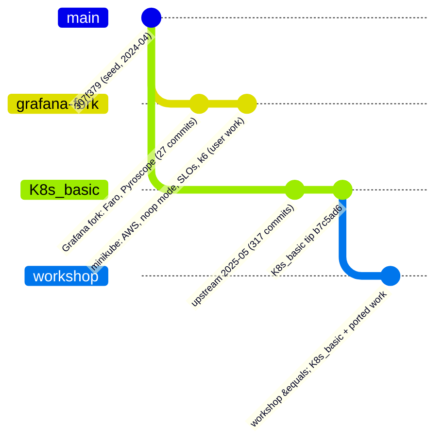
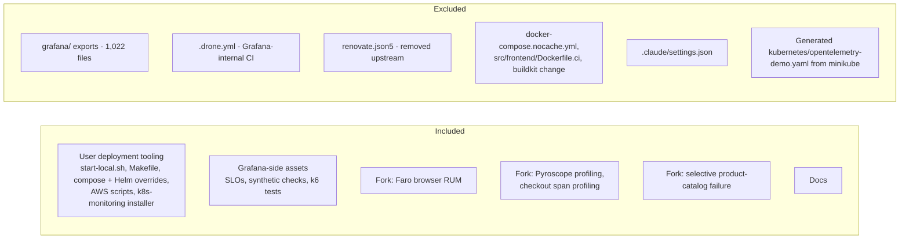

<!-- markdownlint-disable MD013 -->

# Workshop Branch Port Plan

Status: **implemented; runtime verification pending** (see section 8) · Branch: `workshop` · Base: `origin/K8s_basic` (upstream OpenTelemetry Demo 2.0.2, May 2025)

This document is the plan for building the `workshop` branch: the 2025 upstream
demo plus (1) the deployment work from the `minikube` branch and (2) the Grafana
fork additions (Faro and Pyroscope). It is updated as work proceeds; the
"Execution log" at the end records what was actually done.

## 1. Why this branch exists

Two lineages share one old ancestor (`307f379`, 2024-04-17):

`minikube` is the older lineage with the extras; `K8s_basic` is the newer
upstream. `workshop` starts from the newer one and brings the extras across.

## 2. Principles

| Principle | Consequence |
|---|---|
| Re-implement, do not merge | Upstream renamed service folders (`checkoutservice` to `checkout`, `otelcollector` to `otel-collector`, ...). A merge would fight those renames. |
| 100% portable | Every environment-specific value (stack IDs, endpoints, cluster names, chart version, AWS settings) comes from an environment variable. |
| Secrets never in tracked files | `.env.example` is tracked with `unknown` placeholders; `.env.local` holds real values and is gitignored. The upstream tracked `.env` is not modified. |
| Validate before commit | `docker compose config`, `helm template`/`lint`, `shellcheck`, and a secret scan on staged files. |
| Documentation matches the code | Every script and file is documented in `docs/`. |

## 3. Scope

## 4. Compatibility audit (summary)

| Item | Result on `K8s_basic` | Action |
|---|---|---|
| Compose service names | Differ (`otelcol` to `otel-collector`, `frontendproxy` to `frontend-proxy`, `redis-cart` to `valkey-cart`, `loadgenerator` to `load-generator`, ...) | Rebuild overrides |
| `docker-compose.vanilla.yml`, `no-otel.yml` | Do not exist | Recreate against new names |
| Helm values (`values-*.yaml`) | Render with chart 0.37.8 | Port; parameterize |
| Collector service name | `otel-collector` in namespace `otel-demo` | Install Alloy as `otel-collector` in `otel-demo` |
| `start-local.sh`, `Makefile` | Reference removed files and old names | Rewrite / re-apply hunks |
| AWS scripts | Depend only on the Helm chart | Port; pin chart version |
| `grafana-cloud-k8s-monitoring` | Independent of repo files | Port; parameterize stack IDs |
| SLO / k6 / check files | Metric names unverified | Verify against live data |

## 5. Phases

### Phase 0 - Preparation

- Pin Helm chart: `0.37.8` (demo 2.0.2).
- Baseline: `docker compose config` and `helm template` on the untouched base.
- Trial-apply each fork change in a scratch worktree and classify
  clean / conflict / obsolete.

### Phase 1 - Configuration foundation

- `.env.example` (tracked, every value `unknown`) and `.env.local` (gitignored).
- Preflight helper that checks every key in `.env.example` has a value.

### Phase 2 - Fork additions

- Faro browser RUM in `src/frontend`.
- Pyroscope profiling; span profiling for `checkout`.
- Selective failure in `product-catalog`.

### Phase 3 - Deployment tooling

- Compose overrides (noop and Grafana-Cloud-only collector).
- Helm values files.
- `start-local.sh` and `Makefile` targets.
- AWS deploy/teardown scripts.
- Grafana Cloud k8s-monitoring installer.

### Phase 4 - Grafana-side assets

- SLOs, synthetic checks, k6 tests, with all stack-specific values parameterized.

### Phase 5 - Documentation

- Per-component procedures, a master deployment guide, diagrams.

### Phase 6 - Verification

- Static: compose/helm/shellcheck/secret scan on every commit.
- Runtime: compose on OrbStack, Helm on minikube, telemetry visible in
  Grafana Cloud, Faro and Pyroscope data present, SLO queries return data.

## 6. Decisions

| Decision | Value |
|---|---|
| Helm chart | `0.37.8` |
| Faro and Pyroscope | Included, endpoints via env vars |
| `grafana/` exports | Excluded |
| Drone CI, Renovate, nocache compose, `Dockerfile.ci`, buildkit change | Dropped (internal CI / removed upstream) |
| Secrets handling | `.env.example` tracked, `.env.local` gitignored |

## 7. Execution log

Commits on `workshop`, in order (`git log --oneline origin/K8s_basic..workshop`):

| Phase | What was done | How it was checked |
|---|---|---|
| 0 | Plan document | - |
| 2 | `product-catalog`: selective failure by pod name; **fixed** the fork's regex, which could not match 2025 pod names (it needed a leading hyphen) | Go unit test; the test fails with the original pattern |
| 2 | `checkout`: opt-in Pyroscope profiling in `profiling.go` (starts only when configured; failure to start is a warning, not an exit) | `go build`, `gofmt`; module versions chosen to avoid bumping the pinned OpenTelemetry Go libraries |
| 2 | `frontend`: opt-in Faro (Faro 1.13.3, matching the pinned OpenTelemetry 1.30.x), null-safe helpers, one central API-error hook | `tsc --noEmit`, `next build` |
| 1 | `.env.example`, `.gitignore`, `scripts/lib/common.sh` | exercised: defaults, precedence, `unknown` handling, template renderer, missing-value path |
| 3 | Compose overrides (`grafana-cloud`, `vanilla`, `no-otel`) and collector configs | `docker compose config` for all three; `otelcol-contrib validate` exit 0, and exit 1 for a broken copy |
| 3 | Helm values for 6 modes | each renders with chart 0.37.8; rendered collector configs pass `otelcol-contrib 0.131.0 validate`; Alloy chart renders |
| 3 | `start-local.sh` and Makefile targets | shellcheck clean; the generated Helm extras tested in three configurations (this found and fixed a bug that would have deleted the frontend and checkout components) |
| 3 | `grafana-cloud-k8s-monitoring/install.sh` | shellcheck clean; template renders and the chart renders for 5 chart versions; **chart pinned to 4.6.0** because the original `^4` now fails validation |
| 3 | `deploy-aws.sh`, `teardown-aws.sh` | shellcheck (the original had an error: a stray character before the shebang), YAML heredocs rendered; **not run against AWS** |
| 4 | Grafana assets as templates, `render-assets.sh` | k6 scripts pass `k6 inspect` (negative control exits 107); rendered YAML parses; cart/checkout request shapes corrected from the handler code |
| 5 | Documentation | link and anchor check |

## 8. Verification status

**Run live (2026-11-09), Docker Desktop, `./start-local.sh --vanilla`:** all 21
containers start on the 2.0.2 images and stay up; the shop, load generator and feature
flag pages answer 200; `GET /api/products`, `GET /api/cart?sessionId=...`, adding an item
to the cart and placing an order all answer 200; the noop collector receives telemetry;
none of Jaeger, Grafana, Prometheus or OpenSearch starts. The first attempts found two
real defects, both fixed:

- a stale container from another project held the fixed name `load-generator` (documented
  in the troubleshooting table);
- the upstream `.env` sets `DEMO_VERSION=latest`, so Compose pulled today's images, which do
  not match this compose file (`flagd-ui` crashed with `SECRET_KEY_BASE is missing`, `kafka`
  failed its health check). The workshop now defaults `DEMO_VERSION` to 2.0.2.

The same test showed the original synthetic checkout check returns 500; it was corrected
and ships disabled.

**Grafana Cloud run (2026-11-09): attempted, did not pass.** `./start-local.sh --grafana-cloud`
started all 21 containers with no local backends, but the collector's exports to
`otlp-gateway-prod-us-east-2.grafana.net` all failed with **HTTP 401** (traces, metrics and
logs). A direct request with the same credentials also gave 401, so the collector config is
not at fault. The token's embedded region is `prod-us-east-0` while the endpoint and instance
ID are for a `prod-us-east-2` stack: tokens only work in their own region. The script now
tests the credentials (region match, then one request) before deploying and stops on a
mismatch or a 401/403 (`scripts/tests/credential-check-test.sh`). Data reaching Grafana Cloud
has therefore **not** been confirmed yet; it needs a token created for the stack's region.

**Still not run:**

- a Grafana Cloud run with valid credentials (see above);
- any Kubernetes mode on a live cluster, the AWS scripts, and the k8s-monitoring
  installer against a cluster (charts render only; the Alloy operator creates the
  receiver Service at install time);
- Faro and Pyroscope against Grafana Cloud (built and type-checked only);
- the SLO PromQL metric names against this branch's metrics.

Deviations from the fork, on purpose: Drone CI, Renovate, `docker-compose.nocache.yml`,
`src/frontend/Dockerfile.ci`, the buildkit change and the banner text were not
ported; the `grafana/` exports were left out; the Faro tracer replaces the
OpenTelemetry browser tracer only when configured (the fork replaced it always).
